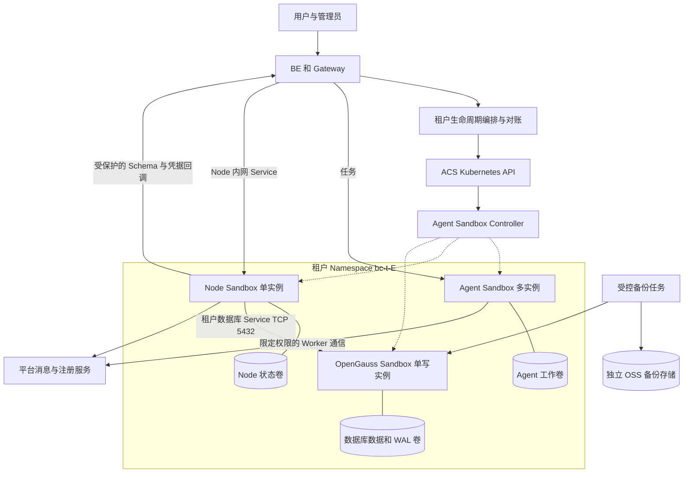
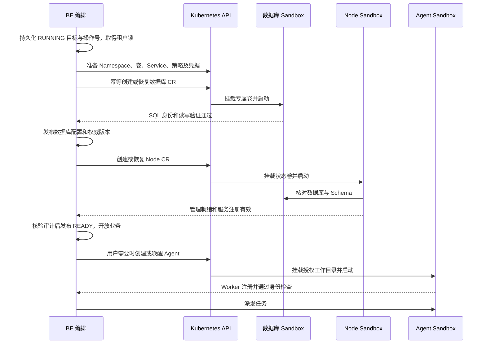
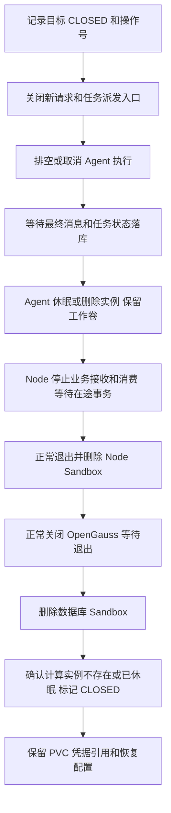
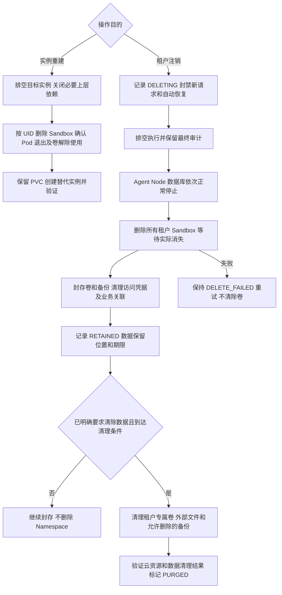

# ByClaw 阿里云容器版沙箱迁移方案

日期：2026 年 10 月 19 日。状态：设计方案，可进入概念验证，生产切换以本文验收条件为准。

目标是将 Agent 执行环境、Tenant Node 数据服务和租户 OpenGauss 数据库全部运行在阿里云 Agent Sandbox 容器版中。每个租户拥有一个 Node、一个数据库和按需分配的多个 Agent Sandbox；平台 BE 负责依赖编排，阿里云控制器负责实际实例生命周期。三者使用独立持久卷，关闭、计算实例删除和数据清除分别操作。

本期只交付设计，不创建云资源、不改变数据库、不修改生产配置。现有平台数据库、BE、Gateway、Redis 等控制与公共服务不纳入这三个服务的迁移范围。部署地域、账号、VPC 和性能规模在环境准备阶段填写，不假定当前开发机或 K3s 已连接阿里云。

## 目标与技术决策

| 决策 | 本方案采用的方式 | 原因 |
| --- | --- | --- |
| 沙箱平台 | 阿里云 ACS 上的 Agent Sandbox 容器版 | 使用官方支持的控制器与 Sandbox CR |
| 控制协议 | 第一阶段统一使用 Kubernetes API 管理三个服务的 Sandbox CR | 可显式配置卷、Service、探针与生命周期，不将数据库绑定到 E2B HTTP 代理 |
| 对象组织 | 每租户 Namespace `bc-t-<enterpriseId>` | 统一资源归属、RBAC、配额、策略和后续 Team 映射 |
| 实例组织 | 三类独立 Sandbox，不合并进同一个 Pod | Agent 回收不影响数据服务，分别升级和恢复 |
| 租户数据实例 | 独立 Sandbox CR，固定逻辑身份，单写实例 | Node 和数据库不进入跨租户共享预热池 |
| Agent 创建 | 第一阶段独立 Sandbox CR，第二阶段再引入租户内 SandboxSet 和 SandboxClaim | 先验证正确性，避免预热、Claim、动态挂载和凭据委托同时成为迁移前置依赖 |
| 关闭 | Node 和数据库正常停止后删除计算实例，保留外部 PVC；Agent 初期同样可采用该方式 | 从已落盘状态恢复，不依赖进程内存保存 |
| Agent 优化 | 验证通过后使用 `spec.paused` 休眠与唤醒 | 降低空闲成本，恢复后重建连接和 Worker 注册 |
| 数据保留 | PVC 独立创建，不归 Sandbox 所有；PV 使用保留策略 | 删除 Sandbox 不连带删除业务数据 |
| 数据库卷 | 优先验证独立 ESSD 块存储 PVC | 数据目录和 WAL 不放对象存储挂载或临时 rootfs |
| 业务接入 | Node、数据库使用内网 Service；Agent 入口由 BE 授权代理 | 不公开租户数据端口，不沿用 Docker 容器名寻址 |

阿里云 [Sandbox CRD 文档](https://help.aliyun.com/zh/agent-sandbox/sandbox-crd-field-descriptions) 提供内联 Pod 模板、PVC 模板、期望与观测状态，并给出了 ESSD StorageClass 示例。这支持选择 Kubernetes CR 作为统一控制入口；具体地域、卷型、镜像和数据库行为仍需在目标集群验收。

验收后的目标能力包括：按顺序开通与恢复、按反向依赖关闭、单实例重建不丢持久数据、确认云端删除后才完成实例销毁，以及独立的数据保留和清除流程。第一阶段提供单实例数据库恢复能力，不承诺跨可用区数据库高可用或零停机升级。

## 官方文档形成的实施边界

| 文档依据 | 能力或限制 | 对方案的影响 |
| --- | --- | --- |
| [创建容器版](https://help.aliyun.com/zh/agent-sandbox/create-an-agent-sandbox) | 支持 CR 和 E2B；SandboxClaim 过期清理不会自动删除已领取的 Sandbox | BE 必须保存实例身份并显式回收；不拿 Claim TTL 当实例 TTL |
| [CRD](https://help.aliyun.com/zh/agent-sandbox/sandbox-crd-field-descriptions) | `Running` 不是完整的就绪证据，存在 Ready、SandboxPaused、SandboxResumed 等条件 | 同时核验目标版本、条件、Pod UID 和业务探测 |
| [Checkpoint](https://help.aliyun.com/zh/agent-sandbox/clone-agent-sandbox-using-checkpoint) | 当前保留内容仅支持 filesystem | 不承诺内存、连接恢复；不用于复制已绑定租户数据的通用模板 |
| [升级](https://help.aliyun.com/zh/agent-sandbox/upgrade-pre-warmed-pools-and-claimed-sandboxes) | 默认 Recreate 不保留 rootfs、内存、IP；CheckpointRestore 不能更换业务镜像 | 镜像升级依靠外部卷，连接与注册地址必须可更新 |
| [容器重启](https://help.aliyun.com/zh/agent-sandbox/restart-agent-sandbox-containers) | CRR 可重启指定容器；rootfs 保留依赖实例类型及注解 | “重启容器”“重建 Pod”“删除 Sandbox”分开建模 |
| [Sidecar 注入](https://help.aliyun.com/zh/agent-sandbox/configure-automatic-sidecar-injection-for-agent-sandbox) | Command、Filesystem 依赖 agent-runtime；动态 CSI 挂载涉及特权及指定 hostPath 的前提 | 不为三个服务无差别注入所有 Sidecar；初期采用静态 PVC |
| [网络规划](https://help.aliyun.com/zh/agent-sandbox/network-planning-and-scaling) | 要求沙箱独立安全组；交换机和安全组变更不自动作用于已分配实例 | 创建时确定网络分区，变更通过受控重建完成 |
| [Team 和 API Key](https://help.aliyun.com/zh/agent-sandbox/manage-api-keys-and-teams) | Team 名称对应已有 Namespace；普通 Key 的 Sandbox 访问范围还与创建 Key 有关 | 不假设同 Team 新 Key 自动接管旧实例；轮转必须验证 |

产品概述和计费页存在内存状态描述，而 CRD、Checkpoint 和休眠操作页的可配置保证更窄。本方案采用操作接口承诺的文件系统和外部卷恢复路径。入口 JWT 文档部分段落仍写“不自动刷新”，专门的轮转文档已给出新版本能力；采用后者的明确版本前提，不把不同页面的能力拼成无条件承诺。

## 部署架构与资源归属



每个 Sandbox 和其 Pod 模板同时设置租户、角色、逻辑实例和操作标识标签。建议标签为 `byclaw.io/tenant-id`、`byclaw.io/role`、`byclaw.io/runtime-id`，值从已验证的服务端上下文生成。用户不能提交任意 Namespace、镜像、卷或身份标签。

持久化身份至少包含 provider、clusterId、namespace、Sandbox name/UID、当前 Pod UID、role、logicalResourceId、enterpriseId、userId、generation、operationId、specHash、volumeRefs、desiredState 和 observedState。Kubernetes `metadata.generation` 只表示 CR 变更版本，不等于业务租户 generation。

Agent 的完整复用键为 `cluster + enterpriseId + userId + sandboxType + resourceId`。个人空间使用明确的个人作用域，不把缺失企业值自动映射到某租户。锁、两级缓存、Worker ID、服务发现、端点和文件权限必须使用同一作用域，不能只修改数据库查询。

Node、数据库各有一个稳定逻辑 Service。Service selector 指向当前 runtime-id；Pod 重建时依靠唯一模板标签继续选择正确实例，替代实例创建时由编排器核验身份后切换 selector。不能用过宽的 `role=database` 同时选中旧、新两个数据库，也不能直接编辑控制器生成的 Pod。

如果 BE 暂留原环境，必须先打通到 ACS API、Node Service/端点、数据库探测地址及回调地址的私网路由和 DNS。跨集群环境不能假定 `*.svc.cluster.local` 自动可达。此条件不满足时先完成网络接入，不通过公开数据库端口解决。

## 控制面与数据面接入

### 第一阶段统一控制

BE 内新增阿里云运行时适配器，以受限 Kubernetes 凭据操作已授权租户 Namespace 下的 Sandbox、Pod 查询、Service 和操作任务。Namespace、StorageClass、网络基线、卷与 Secret 的准备使用独立的资源管理职责；不让普通任务派发代码拥有删除 PVC 或 Namespace 的权限。

首期三个服务均采用独立 CR，因此不需要依赖 E2B Key 来管理数据库。受信任的管理命令通过 Kubernetes Pod exec 适配器执行，Pod 必须从 Sandbox status 和 owner UID 解析，且核验租户、角色和当前实例版本。shell、流式 stdout/stderr、退出码、超时、取消和进程跟踪都由命令接口单独验收；不能把 exec 连接关闭等同于后台进程已终止。

文件访问继续走统一文件服务或受授权的卷路径适配器；必须保留现有路径校验、权限、上传下载和流式行为。需要通过 exec 传输文件时单独实现并测试协议，不能把本地 BE 文件路径当作云端沙箱路径。

### 第二阶段 E2B 和预热

E2B 主要用于 Agent 工具接口、预热分配和浏览器入口优化。Agent 在租户 Namespace 中建立 SandboxSet，通过 SandboxClaim 领取后绑定租户内工作卷；凭据和用户数据在领取后注入。已领取实例永不自动回到通用池。Node 和数据库保持独立 CR。

开启 E2B 时映射 `Team = bc-t-E`，先建立 Namespace，再创建对应 Key。平台保管 Key，前端和 Agent 容器不持有 admin Key。采用的版本必须验证创建 Key 归属、子 Key 和轮转后访问已有实例的行为。

[SandboxGateway](https://help.aliyun.com/zh/agent-sandbox/use-sandboxgateway-to-forward-data-plane-traffic) 负责 HTTP 数据流量，控制面和数据面分离部署。数据库 TCP 5432 不经过此 HTTP 路由；Node 内部 API 走私网 Service 并保留应用鉴权。浏览器、预览等经过 BE 代理授权，代理剥离用户传入的沙箱路由头，再写入服务端核验的目标和凭据。

E2B 原生 SDK 不代表自动适配所有自定义镜像；通用命令执行与 Jupyter `run_code` 是不同能力。首期不引入 Jupyter code-interpreter 作为 OpenClaw 的启动前提。

## 镜像与存储配置

### 镜像契约

三个镜像均从同地域可访问的仓库拉取，锁定版本和 digest，提前校验架构、UID/GID、启动命令、信号处理、就绪探针和恢复行为。当前 openGauss 启动补丁由 BE 复制到宿主目录，迁移后应固化到受控数据库镜像，或通过只读配置挂载；不继续依赖 BE 和沙箱共享本机文件系统。

Agent 镜像包含现有 Worker 及执行依赖。仅在使用 E2B Commands/Filesystem 时注入 agent-runtime，并满足文档要求的 shell 和基础工具。Node 和数据库使用业务入口启动，不为获得“沙箱”身份额外开启 envd、Jupyter 或动态 CSI。

Node 保留固定企业、generation、数据库记录身份以及状态目录。数据库启动程序只在明确的首次初始化流程创建库和账号；发现已有卷、初始化中断标记或身份不符时必须验证并恢复或报错，禁止自动格式化、覆盖或重新初始化。

### 卷选择与生命周期

| 数据 | 首期存储 | 关闭及实例重建 | 租户注销默认行为 |
| --- | --- | --- | --- |
| 数据库数据与 WAL | 独立块存储 PVC，按集群支持情况选择 ESSD StorageClass | 保留并重新挂载，禁止并发写实例 | 封存，等待数据清理策略 |
| Node authority、Schema task、审计结果 | 独立持久 PVC | 保留，启动时核对版本与代际 | 封存 |
| Agent 私有工作目录 | 独立 PVC；跨实例共享需求使用经过权限验证的 NAS/AgenticFS | 保留，按逻辑资源重新授权挂载 | 封存 |
| Agent 共享项目目录 | 按项目授权的文件卷，读写范围明确 | 保留，避免整个租户根目录挂载 | 按项目所有权清理 |
| 临时 rootfs、缓存、emptyDir | 实例临时存储 | 可丢失 | 随实例释放 |
| 成果归档、备份 | OSS 独立前缀及受限凭据 | 独立保留 | 单独执行保留期限及删除策略 |

外部 PVC 不设置指向 Sandbox 的 ownerReference；PV 的 reclaimPolicy 采用 Retain，并核验 StorageClass、CSI 和云盘实际删除行为。Retain 不等于“可以删除 Namespace 后自动恢复 PVC”：Namespace 清理必须等所有卷完成封存、重绑定计划或明确删除后再执行。

ReadWriteOnce 不是数据库单写锁。编排器还必须保证旧 Pod 退出、卷解除使用及旧实例写入资格撤销后，才能创建或开放新数据库写实例。单可用区云盘不能提供自动跨可用区故障切换；出现可用区故障时从备份恢复到新卷，或另立数据库复制方案。

数据库目录不采用 OSS/FUSE 挂载。OSS 用于归档和备份；AgenticFS 可用于 Agent 工作目录，但必须验收 git、小文件、重命名、权限及恢复行为，不将其可挂载能力等同于 openGauss 数据目录兼容性。[OSS 挂载](https://help.aliyun.com/zh/agent-sandbox/mount-oss-storage-for-an-agent-sandbox)与 [AgenticFS 挂载](https://help.aliyun.com/zh/agent-sandbox/mount-agenticfs-for-agent-sandbox-with-agent-identity)均有身份、组件与网络前提；动态挂载不是首期数据库的必要依赖。

### Sandbox 模板结构

以下只说明共同结构，不是可直接投产的清单。镜像、StorageClass、PVC、网络注解、Secret、启动命令、身份以及各服务探针必须由环境准备和镜像验收填充，不能复制示例后直接开通租户。

```yaml
apiVersion: agents.kruise.io/v1alpha1
kind: Sandbox
metadata:
  name: bc-db-e123-r1
  namespace: bc-t-123
  labels:
    byclaw.io/tenant-id: '123'
    byclaw.io/role: database
    byclaw.io/runtime-id: db-e123-r1
spec:
  paused: false
  template:
    metadata:
      labels:
        alibabacloud.com/acs: 'true'
        alibabacloud.com/compute-class: agent-sandbox
        alibabacloud.com/compute-qos: default
        byclaw.io/tenant-id: '123'
        byclaw.io/role: database
        byclaw.io/runtime-id: db-e123-r1
    spec:
      automountServiceAccountToken: false
      enableServiceLinks: false
      terminationGracePeriodSeconds: 120
      containers:
        - name: main
          image: '<validated-opengauss-image>@sha256:<digest>'
          volumeMounts:
            - name: data
              mountPath: '<validated-data-directory>'
      volumes:
        - name: data
          persistentVolumeClaim:
            claimName: db-data-e123
```

Node 和 Agent 使用相同资源结构、各自镜像和 PVC。持久实例省略 `shutdownTime`、`pauseTime`，不配置自动休眠；Agent 的休眠由业务编排显式触发。若第二阶段通过 E2B 创建常驻服务，另行配置其 never-timeout 行为，不能把该 metadata 参数当成第一阶段 CR 的字段。

## 启动与恢复流程



启动操作使用稳定 operationId、确定性对象名及 specHash。创建请求超时后查询原对象，不换名字重试；读取 Namespace、CR UID 和标签确认归属，防止误接管同名对象。记录创建成功但响应丢失的场景必须能够对账恢复。

数据库就绪至少核验 `current_database()`、`current_user`、预期实例身份和可写能力；首期开通用受控测试数据验证提交与读取。生产探针避免反复修改真实业务数据。Node 管理就绪与业务 READY 保持分层，避免 BE 等待 Node READY、Node 又等待租户 READY 的循环。沿用当前 Schema bundle 审计协议，不能因 Pod 已启动就跳过 Schema 验证。

数据库逻辑实例被替换时，更新 DB_SANDBOX_RECORD_ID，递增业务 generation/fencingToken，向新 Node 注入匹配身份。普通同实例 Pod 重启不随意改变租户 generation；权威版本变化由串行编排决定。旧 Node 失去权威后不得提交新写入，Node 的持久版本下限必须保留。

业务配置租约与云实例租期是两件事。`READY` 租约续期任务只续 RUNNING 且真实就绪的租户；CLOSED、DELETING、恢复失败状态不得被旧续租逻辑重新发布为 READY。

## 关闭与重新打开流程

### 关闭语义

停止任务只取消对应执行，不改变三个实例的生命周期。关闭是可恢复停机；实例删除是计算资源操作；清除数据是另外的不可恢复操作。

第一阶段关闭 Node 和数据库采用正常停机后删除 Sandbox、保留 PVC。这样即使它们不休眠，三个服务仍全部运行在容器版 Sandbox 中；重新打开时创建新计算实例挂载原卷。该路径不依赖进程退出后还能被休眠的假设。



不能在排空前直接删除 TENANT_CONFIG，因为 Node 提交前会校验该权威配置，可能导致最终状态无法落库。关闭流程先拒绝外部新业务，保留完成在途写入所需的受限权威窗口；排空完成后撤销业务写入资格。需要给 Node 增加 drain 管理协议，明确停止接受、停止领取、处理结束与消费者 ACK 的顺序。当前 SIGTERM 处理只能作为基础，不能未经测试就等同于业务排空完成。

数据库镜像提供受控 stop 动作和 TERM/preStop 处理，使用与镜像版本匹配的 `gs_ctl` 正常停止并等待结束。`fast` 会回滚仍活跃的事务，所以正常关闭前先排空写入；不把 `immediate` 作为正常关闭策略。超时进入 CLOSE_FAILED 并记录剩余实例，不自动强删和宣称成功。[openGauss 控制工具](https://docs.opengauss.org/zh/docs/5.0.0/docs/ToolandCommandReference/gs_ctl.html)

第二阶段 Agent 可通过 `spec.paused=true` 休眠。判定成功必须读取 SandboxPaused=True，恢复检查 SandboxResumed、Ready 和业务注册；不能只读取 phase。当前[休眠说明](https://help.aliyun.com/zh/cs/user-guide/hibernate-and-wake-up-the-agent-sandbox)要求在无活跃请求和长连接时执行，Redis 长连接、Worker 心跳和定时任务需要应用配合。Redis 消息本身不视为入口流量唤醒信号，BE 在派发前显式唤醒。

重新打开执行数据库、Node、Agent 的正向顺序。先恢复租约和管理阶段配置，再开放业务。保持对 CLOSED 的对账，不因“实例不存在”就触发故障自动拉起。

## 销毁与数据清除流程



删除请求使用 UID precondition，避免旧操作误删同名的新实例。只有 CR、对应 Pod、必要的卷使用状态都确认后，实例记录才能标记 RELEASED。404 只能在查询权限和集群连通正常且作用域正确时解释为不存在；超时、403 或 API 故障标为 UNKNOWN，不等同于删除成功。

注销默认保留数据，需要新的明确数据清除操作才进入 PURGING。保留期限、备份到期时间和冻结要求在生产开通前由业务确定；没有配置时不自动清理。停止后磁盘和备份仍可能计费。移除平台映射前保存卷 ID、备份位置、加密密钥引用和审计，避免封存后无法找回数据。

卷不随 Namespace 一次性删除。删除共享项目数据前核对其所有权和其他租户/用户引用；只能清理该租户实际拥有的数据。Checkpoint 可能包含文件、凭据和历史环境，纳入同一保留清单，不作跨租户模板。

## 网络与凭据方案

### 网络流向

| 来源 | 目标 | 允许范围 |
| --- | --- | --- |
| BE 编排 | ACS API | 管理 HTTPS，仅平台身份 |
| BE 业务服务 | 对应租户 Node | Node 实际服务端口，保留应用鉴权 |
| Node | 本租户数据库 | TCP 5432，数据库认证及传输加密按镜像验证 |
| Agent Worker | 平台消息与注册服务 | 所需端口及受限租户权限 |
| Node | 平台 Redis、BE 回调 | 所需端口，按租户限定身份和操作 |
| BE 开通与数据源管理 | 本租户数据库 | 必要的 SQL 探测和已授权管理，不允许任意用户直连 |
| Agent | 授权模型服务与外部工具 | 通过业务模型代理或受控出网策略 |
| 备份执行身份 | 本租户数据库及备份存储 | 专用身份、时间窗口和租户前缀 |
| Agent | 任意租户 Node/数据库、Kubernetes API、云元数据 | 默认拒绝 |

采用沙箱独立 vSwitch、安全组和 TrafficPolicy。进一步把 Agent 执行与 Node/数据库数据服务使用不同安全组，防止“同为 Sandbox”就被统一放行。跨租户默认拒绝，同租户也只放行上表列出的连接。DNS、镜像拉取、监控和可选 CredentialProvider 依赖单独列入基线，不照搬官方示例中的全部公网允许规则。

[TrafficPolicy](https://help.aliyun.com/zh/agent-sandbox/use-trafficpolicy-to-manage-agent-network-access-1) 与原生 NetworkPolicy 的组合语义不同，需按优先级及命中顺序设计；基于 Service 的策略有下发延迟。先配置安全组和默认拒绝，再启动含凭据的实例，实际正向与拒绝探测通过后开放业务。

第二阶段使用 [E2B network 配置](https://help.aliyun.com/zh/agent-sandbox/agent-sandbox-egress-traffic-control-best-practices)时，`allow_out` 本身不会形成完整默认拒绝，需配合拒绝其余目的地的规则；该 SDK 路径当前主要控制 TCP，不覆盖所有 UDP、ICMP 或 IPv6。平台高优先级的元数据与跨租户拒绝规则不能被每实例 priority 100 的策略覆盖。DNS UDP/TCP、IPv4/IPv6 与原始 IP 访问分别测试，不能用一次 HTTPS 拒绝测试替代网络隔离验收。

Agent 需要 L7 出网治理时再启用 enhanced-traffic-policy。须验证代理保留端口、UID/GID 1337、DNS 和 CA 注入；内部 Redis、数据库、mTLS 回调按明确规则处理，不能把所有协议都当作 HTTP 做凭据替换。[增强型出口管理](https://help.aliyun.com/zh/agent-sandbox/manage-agent-sandbox-egress-traffic)

### 凭据与业务授权

数据库 bootstrap Secret 仅挂载数据库实例；Node 继续读取加密信封并通过绑定企业、库名及实例身份的内部接口取凭据。平台解密主密钥不进入三个 Sandbox。BE 到 Node 的当前共享 Token 需要逐步改为租户独立凭据或 mTLS 身份，Java 客户端现有仅接受 HTTP 的检查也要同步调整。

Agent 不接收全权限 Redis 密码。先盘点 by-framework 的流、注册、心跳及发现键，再配置按租户和角色限定的 Redis ACL；若共享注册键无法细分，使用平台受控的注册/消息代理完成共享部分，不以开放全局读写作为验收替代。多租户消息伪造、跨租户读取以及全局注册覆盖均需拒绝测试。

模型 API Key 首期继续由已有平台模型代理管理。第二阶段可用 CredentialProvider 和 SecurityProfile tokenTransformation 对指定 HTTP API 注入凭据；该能力不自动覆盖原生数据库协议，也不直接替代目前的 SM4 数据库凭据信封。[凭据注入](https://help.aliyun.com/zh/agent-sandbox/inject-credentials-for-agent-sandbox-egress)

Kubernetes Secret 来源的 CredentialProvider 只能引用同 Namespace Secret；KMS 来源另需专属实例、OIDC 和组件权限。资源 Available=True 不等于已经成功取到真实凭据，必须执行一次受限实际调用。[Secret 来源](https://help.aliyun.com/zh/agent-sandbox/use-kubernetes-secret-api-key-credentials-with-credentialprovider)、[KMS 来源](https://help.aliyun.com/zh/agent-sandbox/use-kms-secret-api-key-credentials-with-credentialprovider)

E2B 数据面入口如启用 JWT，明确配置令牌寿命并验证刷新。当前[自动轮转文档](https://help.aliyun.com/zh/agent-sandbox/configure-trafficaccesstoken-auto-rotation-for-agent-sandbox)依赖 manager >= 0.6.12，且自动补丁明确限定 Python SDK 版本范围；ByClaw Java 端不能假定获得同样能力。首期内部 Service 路径不依赖该 JWT；后续启用前必须实现并测试所选客户端的令牌获取、轮转、过期与撤销。

## 状态模型与故障对账

平台业务状态和云端观测状态分开保存：

| 类型 | 建议值或内容 |
| --- | --- |
| 目标状态 | RUNNING、CLOSED、ABSENT；数据另设 RETAIN/PURGE |
| 操作状态 | PENDING、DRAINING、APPLYING、VERIFYING、SUCCEEDED、FAILED |
| 云端观测 | CR phase、conditions、observedGeneration、Pod UID、卷状态、最后观测时间 |
| 业务就绪 | 数据库身份、Node 管理就绪/业务就绪、Worker 注册和服务身份 |
| 数据处置 | ACTIVE、RETAINED、PURGING、PURGED |

这些是拟新增的领域状态，不是阿里云 CRD 字段，也不是当前数据库已存在的字段。是否复用现有配置纵表或增加结构化持久表在实现阶段确定；涉及任何 DDL/DML，先由用户指定确切迁移版本。

对账采用租户操作锁、持久化操作号、递增 fencing token 以及乐观并发版本。长操作续租锁；锁丢失后不得再推进旧操作。不能把现有十分钟锁的存在直接视为长时间迁移的完整互斥保障。云对象 metadata UID 和业务身份同时约束操作，确保删除与启动不能相互覆盖。

| 故障 | 处理 |
| --- | --- |
| 创建或删除响应超时 | 查询同一 UID/对象并恢复原操作，不换名重复创建 |
| API 不可达 | 标记 UNKNOWN，保持数据与恢复记录，停止破坏性后续步骤 |
| 数据库未就绪 | Node 不开放业务，Agent 停止新任务；保留卷并告警 |
| Node 未就绪 | 数据库继续运行；重建 Node 前确认旧实例退出 |
| Agent 异常 | 只恢复该执行环境；读取持久任务状态防止重复执行 |
| 数据库旧实例不确定是否退出 | 禁止第二个写实例挂载，不通过强制忽略锁绕过 |
| PVC、Secret 或策略缺失 | 进入明确失败，禁止临时降级到无持久化或无鉴权启动 |
| 平台重启或多 BE 并发 | 从持久操作和真实云状态恢复，不依赖内存任务队列 |

## 现有代码改造清单

以下路径均相对仓库根目录，列出迁移边界，不表示当前已经具备新能力。

| 入口 | 当前行为 | 改造内容 |
| --- | --- | --- |
| `byclaw-be/src/main/java/com/iwhalecloud/byai/gateway/sandbox/runtime/SandboxRuntimeProvider.java` | create/remove/heartbeat 等通用接口，但请求类型与 OpenSandbox 模型耦合 | 增加作用域、运行时身份、能力声明；抽离厂商无关 LaunchSpec，暂停/恢复及观察使用明确能力接口 |
| 同目录 `StandardSandboxLifecycleService.java` | Redis key 仅 userCode+sandboxType，启动复用及创建锁在此 | 接入 cluster/tenant/user/resource 作用域；按记录 provider 路由，兼容旧实例 |
| `gateway/sandbox/config/SandboxAutoConfiguration.java` | 现有 OpenSandbox/WhaleAgent 选择 | 注册阿里云适配器，新增实例按租户灰度，存量继续按原 provider 管理 |
| `gateway/sandbox/service/SandboxService.java` | 用户资源复用、Worker ID、释放后本地状态 | 全链路加租户身份；远端删除失败不能直接 RELEASED；支持 CLOSED 目标 |
| 同目录 `SandboxMetadataCache.java` 及端点注册相关类 | 用户与类型维度索引 | 同步隔离缓存、服务发现、端点及失效操作 |
| 同目录 `TenantSandboxService.java` | 直接使用 OpenSandboxClient，准备宿主目录，删除本地租户目录 | 通过运行时和卷服务操作；卷封存与清除分开，取消云模式本地递归删目录 |
| `manager/domain/tenant/TenantDbProvisioningService.java` | 开通、重建、租约发布；generation/fencingToken 初值固定 | 保留 Schema 顺序，增加目标状态、版本推进、停止与恢复、可靠对账 |
| 同目录 `TenantDeletionService.java` | 删除配置、实例及本地目录，未覆盖用户级 Agent | 枚举该租户所有运行时；先排空、后撤权和删除；新增保留与清除操作 |
| 同目录 `TenantNodeClient.java` | 服务发现和身份校验，当前接受 HTTP | 兼容稳定 Service 与 mTLS/租户凭据，不把 Sandbox ID 拼成容器地址 |
| `gateway/sandbox/command/OpenSandboxCommandExecutor.java` | 直接依赖 OpenSandboxClient | 新增 Kubernetes 命令适配器，按实例 provider 分派；验证流、取消及退出码 |
| `gateway/sandbox/service/ingress/` 与文件服务 | 现有 OpenSandbox 入口与文件路径假设 | 适配私网入口、代理路由和授权存储，保留浏览器长连接行为 |
| `byclaw-be/src/main/resources/tenant/opengauss-entrypoint.py` | BE 复制补丁到共享宿主路径 | 补丁进入受控镜像，补充正常停机和重挂卷恢复契约 |
| `byclaw-tenant-node/src/main.ts`、`bootstrap.ts` | 已有信号处理、runtime stop 与连接关闭 | 增加可观测 drain，测试 ACK、在途事务和 Schema task 收尾 |
| `byclaw-fe/src/pages/manager/pages/SandboxMgr/` 与租户管理 | 显示现有运行/释放状态 | 区分实际观测、关闭、重建、数据封存和永久清除，不拿 API 接受当操作完成 |

当前 mapper 中 USER 与 TENANT 的过滤需要保留，同时为 USER Agent 记录写入实际 enterpriseId。仅修改 ownerScope 不能解决租户切换后的 Worker 和文件隔离。执行使用的身份必须显式跨异步线程传递，不能从用户默认企业或线程上下文临时推断。

## 版本与环境准备

目标集群先选支持的稳定 Kubernetes 版本，POC 可从 1.32 或更高的受支持版本开始；不是要求现有集群直接升级。锁定具体版本和组件镜像摘要后再开始测试。

| 功能 | 文档中的最低前提 | 本方案处理 |
| --- | --- | --- |
| 基本创建 | virtual-node >= 2.17.0；创建页列出的 controller/manager 与 scheduler 要求 | 环境基线检查，选目标地域支持的兼容版本组合 |
| CRR 容器重启 | virtual-node >= 2.18.0，ack-kruise >= 1.8.4，controller 按文档升级 | 纳入兼容矩阵，不作为正常关闭的唯一手段 |
| 自动 Agent 休眠 | controller >= v0.6.6-release.1 并启用相应特性 | 第二阶段再启用 |
| 入站流量自动唤醒 | manager >= v0.6.12-release.1 | 只覆盖受支持入口，不代替 Redis 派发前显式唤醒 |
| AgenticFS 身份挂载 | identity >= 0.5.1、controller >= v0.6.1-release.1、manager >= 0.6.11，并配置 RRSA、TLS 接入点 | 可选增强，按 AccessPoint 收敛权限 |
| JWT 轮转 | manager >= 0.6.12，指定 Python SDK 范围或自行验证客户端 | Java 端不默认宣称支持 |

最低版本是各功能的分别要求，不代表这些版本任意拼接就兼容。POC 输出一份实际已验证的版本组合。镜像缓存、私网仓库、DNS、API 访问、CSI、时间同步、证书、资源配额和安全组双向规则均在此阶段配置。

## 分阶段实施与准入

| 阶段 | 交付物 | 通过条件 |
| --- | --- | --- |
| P0 基础可行性 | 目标集群清单；三个真实镜像的 Sandbox CR；外部 PVC、Service、网络策略；测试结果 | 实际 openGauss 在独立持久卷上完成启动、提交、正常停止、重建、异常恢复和备份恢复；否则不进入生产迁移 |
| P1 运行时接入 | provider/命令/存储/端点适配器；完整租户作用域；操作持久化与对账 | 新建测试租户能够完成 DB→Node→Agent；跨租户及多 BE 并发测试通过 |
| P2 生命周期与迁移 | 关闭、恢复、重建、封存/清除流程；存量迁移与回滚脚本 | 同一租户反复关闭恢复不丢已提交数据，删除失败不触发卷清除；迁移演练可回退 |
| P3 弹性增强 | Agent 休眠、预热池、可选 E2B/Identity/出网注入 | 连接和任务恢复正确，权限及令牌轮转验证，实际账单收益可观测 |
| P4 生产灰度 | 少量租户试运行、监控告警、运维手册和恢复记录 | 错误率、任务一致性、备份和容量满足业务目标后逐批扩展 |

数据库可行性先验证再大量改代码。不能把 Agent 镜像启动成功当作三服务方案通过。未通过数据库卷或镜像验收时，保持三服务目标，明确失败条件并修正配置或镜像；不静默改成 OSS 数据目录或迁换数据库引擎。

### 验收矩阵

| 编号 | 场景 | 必须保留的证据 |
| --- | --- | --- |
| V01 | 三个真实镜像启动 | digest、组件版本、CR/Pod UID、就绪条件及业务探测结果 |
| V02 | 同一用户切换两个租户 | 不同 Agent 作用域，端点、文件、Worker、Redis 均无交叉访问 |
| V03 | 持久卷重挂 | Node authority 和 Schema 结果仍在；数据库已确认事务仍可读取 |
| V04 | 正常关闭再恢复 | 新请求已阻断，最终状态落库，数据库正常停止；原卷恢复成功 |
| V05 | 数据库异常退出 | 只在隔离测试数据上故障注入，恢复后验证事务、索引和业务记录 |
| V06 | 备份与独立恢复 | 用相同受支持工具版本在新实例新卷恢复，校验角色、Schema、序列、对象、行数与实际业务读写 |
| V07 | 删除/创建超时和平台重启 | 不重复创建；UNKNOWN 不当不存在；操作可续跑 |
| V08 | 旧实例未退出时重建 | 第二个数据库写实例被阻止，旧写入资格失效 |
| V09 | 在途任务及 Node 排空 | 不丢最终消息、ACK 和任务终态，不把重放算作新执行 |
| V10 | 实例删但数据留 | Sandbox 消失，PVC/PV/云盘与数据仍存在；Namespace 未级联清理 |
| V11 | 租户清除 | 覆盖所有该租户 Agent、卷、成果、快照及策略允许删除的备份；其他租户和共享项目不受影响 |
| V12 | 网络、凭据和入口 | 跨租户、元数据、API 未授权访问拒绝；自定义端口和 WebSocket 鉴权通过 |
| V13 | 容量与性能 | 冷启动/恢复耗时、SQL 提交延迟、文件操作、任务吞吐及峰值资源的实测分布 |
| V14 | 可选休眠/E2B | Sandbox 条件、连接重建、Worker 注册、定时任务及令牌刷新均可核验 |

不在方案阶段编造性能承诺。P0 根据实测提出启动、恢复、SQL 延迟、RPO/RTO 的业务目标，生产灰度前固定门槛。单实例加周期备份不承诺零数据损失；如要求低 RPO 或跨可用区自动切换，需要增加持续归档或数据库主备复制及仲裁设计。

## 存量迁移与回滚

1. 新开测试租户验证三服务完整链路，再选择少量存量租户演练。按租户保存迁移 operationId、源 provider、卷及镜像版本。
2. 在目标侧准备 Namespace、三个外部卷、策略和兼容镜像，保持目标业务入口关闭。
3. 封禁源租户新任务，排空 Agent 与 Node 消费，记录消息边界、任务终态和 Schema 审计。对源数据库使用匹配版本的逻辑备份；角色、权限、扩展、序列和必要配置纳入迁移清单。不能只复制一个库文件夹。
4. 在新数据库卷恢复备份，校验库与账号、Schema、序列和业务数据。目标 Node 状态目录迁移保留审计和版本下限；业务 generation 前进，旧 Node 不再获得写入资格。目标端只允许单个消费者接管已确认的消息边界。
5. 迁移 Agent 工作目录、项目授权与必要会话文件，重新生成运行凭据和注册地址，不复制旧控制面 Token。运行时身份改用阿里云 provider 和目标 cluster。
6. 验证通过后切换租户权威配置、Node 服务发现和 Agent 路由，开放目标业务。源实例与数据封存，禁止双写，不立即销毁。
7. 目标接受业务写入前，可以撤销目标并恢复源配置。目标接受新写入后，回滚必须先停目标、备份并回迁增量或完整一致数据，或选择向前修复；不能直接指回旧库。任何回退都需防止队列重放造成重复业务。

逻辑备份和恢复工具遵循 [openGauss 文档](https://docs.opengauss.org/zh/docs/6.0.0/docs/DatabaseOMGuide/%E9%80%BB%E8%BE%91%E5%A4%87%E4%BB%BD%E4%B8%8E%E6%81%A2%E5%A4%8D.html)，工具版本以实际数据库镜像为准。Sandbox Checkpoint 不视作外部数据库卷的一致备份，不用克隆正在写入的租户数据库来创建另一个租户。

## 可观测性与容量成本

接入 Sandbox Controller、Manager 和业务指标。[官方 Prometheus 接入](https://help.aliyun.com/zh/agent-sandbox/enable-prometheus-monitoring-for-acs-agent-sandbox-1)提供生命周期、就绪和 Claim 等指标；同时增加租户操作阶段、业务就绪、积压/ACK、数据库恢复、备份年龄与卷容量告警。日志关联 enterpriseId、operationId、runtime UID、Pod UID 和 traceId，禁止记录凭据与备份明文。实例资源 Running 与租户业务 READY 在管理页分开显示。

[Virtual Node 分片采集](https://help.aliyun.com/zh/agent-sandbox/enable-paging-collection-of-virtual-node-monitoring-metrics)在大规模 Pod 下可分摊采集负载，开启后原 cAdvisor 端点行为变化，采集规则必须同时更新，避免断流或重复计量。

容量估算从 `租户数 × 2 个常驻数据实例 + 活跃 Agent + 预热 Agent + 平台组件` 开始，分别核对 CPU/内存、Sandbox CR/Pod、IP/ENI、PVC/PV/云盘以及 API 创建与删除速率。[使用限制](https://help.aliyun.com/zh/agent-sandbox/product-overview/limits-of-agent-sandbox)中的极速版 24 小时活跃时长不能直接套用到容器版，产品宣传的并发规模也不等于当前账号配额。

成本包括常驻 Node/数据库、Agent 活跃与休眠、外部卷、备份、网关、出网、日志、监控和预热池。按中国内地通用型参考价，假设数据库 2C4Gi、Node 1C2Gi、一个 Agent 2C4Gi，三者全月 720 小时常驻的 CPU/内存约为 `(5×0.078 + 10×0.039)×720 = 561.6 元/租户月`。这是示例规格和估算，不是资源配置建议或报价；不含其他费用、规格规整及平台开销。[计费概述](https://help.aliyun.com/zh/agent-sandbox/product-overview/billing-overview)

较早 ACS 概述仍出现 30GiB 临时存储描述，2026 年 9 月的[调整公告](https://help.aliyun.com/zh/cs/product-overview/product-announcement-on-default-ephemeral-storage-adjustment-for-acs-agent-sandbox)已调整为 15GiB。预算按新规则和目标地域账单核验，不把 rootfs 免费额度视为数据库持久卷免费额度。

## 文档覆盖与参考索引

以下覆盖用户所示容器版侧栏的快速入门、生命周期、用户、存储、网络、安全和可观测性章节，并补充休眠、配额、计费与数据库资料。链接中的具体能力已经在对应设计段落约束，选读的增强功能不作为首期无条件依赖。

| 分类 | 官方文档 | 在本方案中的用途 |
| --- | --- | --- |
| 快速入门 | [创建容器版](https://help.aliyun.com/zh/agent-sandbox/create-an-agent-sandbox) | 集群准备、CR、Claim、入口与删除 |
| 快速入门 | [Sidecar 自动注入](https://help.aliyun.com/zh/agent-sandbox/configure-automatic-sidecar-injection-for-agent-sandbox) | envd 与 CSI 的职责及前提 |
| 快速入门 | [E2B SDK 接入](https://help.aliyun.com/zh/agent-sandbox/connect-to-agent-sandbox-using-the-e2b-sdk) | 原生与私有协议、后续 Agent 工具接口 |
| 快速入门 | [Sandbox CRD](https://help.aliyun.com/zh/agent-sandbox/sandbox-crd-field-descriptions) | 原生资源、条件和卷配置 |
| 生命周期 | [Checkpoint 克隆](https://help.aliyun.com/zh/agent-sandbox/clone-agent-sandbox-using-checkpoint) | filesystem 边界与克隆隔离 |
| 生命周期 | [升级](https://help.aliyun.com/zh/agent-sandbox/upgrade-pre-warmed-pools-and-claimed-sandboxes) | 预热池与已领取实例分开升级 |
| 生命周期 | [容器重启](https://help.aliyun.com/zh/agent-sandbox/restart-agent-sandbox-containers) | CRR 及数据保留 |
| 生命周期补充 | [休眠与唤醒](https://help.aliyun.com/zh/cs/user-guide/hibernate-and-wake-up-the-agent-sandbox) | 暂停条件与恢复行为 |
| 用户管理 | [Team 与 API Key](https://help.aliyun.com/zh/agent-sandbox/manage-api-keys-and-teams) | Namespace 映射与 Key 归属 |
| 用户管理 | [RDS MySQL 存储 Key](https://help.aliyun.com/zh/agent-sandbox/store-api-keys-with-rds-mysql) | 后续大量 Key 的管理面存储；首期不额外引入 MySQL |
| 存储 | [OSS](https://help.aliyun.com/zh/agent-sandbox/mount-oss-storage-for-an-agent-sandbox) | 归档及授权路径 |
| 存储 | [AgenticFS](https://help.aliyun.com/zh/agent-sandbox/mount-agenticfs-for-agent-sandbox-with-agent-identity) | 可选工作目录共享与 AccessPoint 权限 |
| 网络 | [入口流量](https://help.aliyun.com/zh/agent-sandbox/use-sandboxgateway-to-forward-data-plane-traffic) | 控制面和数据面分离 |
| 网络 | [TrafficPolicy](https://help.aliyun.com/zh/agent-sandbox/use-trafficpolicy-to-manage-agent-network-access-1) | L4 访问矩阵 |
| 网络 | [增强型出口](https://help.aliyun.com/zh/agent-sandbox/manage-agent-sandbox-egress-traffic) | L7、代理与 TLS 前提 |
| 网络 | [出口凭据注入](https://help.aliyun.com/zh/agent-sandbox/inject-credentials-for-agent-sandbox-egress) | 模型凭据的可选改造 |
| 网络 | [网络规划与扩容](https://help.aliyun.com/zh/agent-sandbox/network-planning-and-scaling) | vSwitch、安全组、容量 |
| 网络 | [E2B 出口访问策略](https://help.aliyun.com/zh/agent-sandbox/agent-sandbox-egress-traffic-control-best-practices) | 后续 SDK 策略兼容性 |
| 安全 | [安全最佳实践](https://help.aliyun.com/zh/agent-sandbox/acs-agent-sandbox-security-best-practices) | 网络、身份与存储隔离 |
| 安全 | [Secret CredentialProvider](https://help.aliyun.com/zh/agent-sandbox/use-kubernetes-secret-api-key-credentials-with-credentialprovider) | 同 Namespace 的凭据来源 |
| 安全 | [KMS CredentialProvider](https://help.aliyun.com/zh/agent-sandbox/use-kms-secret-api-key-credentials-with-credentialprovider) | 云端密钥托管 |
| 安全 | [RAM STS CredentialProvider](https://help.aliyun.com/zh/agent-sandbox/use-the-credentials-provider-to-configure-the-temporary-credentials-of-the-ram-role-sts) | 临时权限收敛 |
| 安全 | [安全责任共担](https://help.aliyun.com/zh/agent-sandbox/security-responsibility-sharing-model) | 平台能力和应用配置责任 |
| 安全 | [TrafficAccessToken 轮转](https://help.aliyun.com/zh/agent-sandbox/configure-trafficaccesstoken-auto-rotation-for-agent-sandbox) | 版本化客户端接入边界 |
| 可观测性 | [Prometheus](https://help.aliyun.com/zh/agent-sandbox/enable-prometheus-monitoring-for-acs-agent-sandbox-1) | 生命周期与资源监控 |
| 可观测性 | [Virtual Node 分片采集](https://help.aliyun.com/zh/agent-sandbox/enable-paging-collection-of-virtual-node-monitoring-metrics) | 大规模采集与费用 |

下一步交付 P0 的环境参数清单与可执行测试清单，然后实现真实环境适配与验收。本设计及其图示保持未暂存、未提交。
