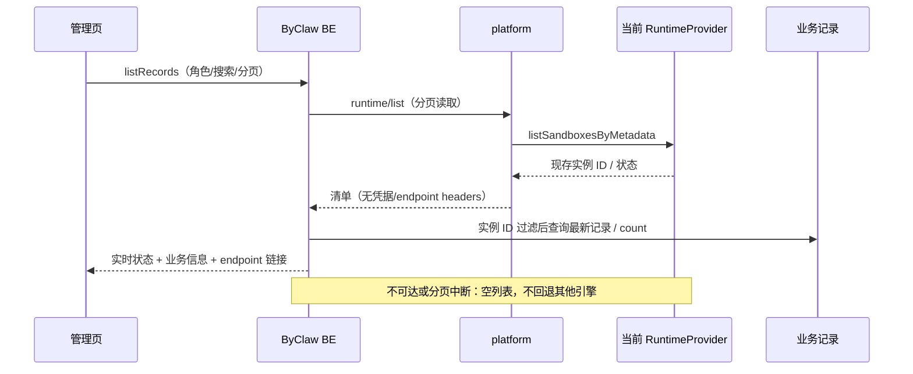

# 沙箱管理页修复（2026-10-22）

## 已确认的行为

- 实时清单的实例 ID 与请求状态是并列条件：有 ID 就限定 `sandbox_id`，请求带了状态就再按持久化 `status` 过滤，两个条件同时生效。清单中的实例展示实时状态，清单外的记录保留库里的状态。
- 当前引擎不可达或分页中断，页面正常返回空列表和 total=0；不弹错误，不返回部分清单，不回退其他 Provider。
- BUSINESS_MAN 与 PLAT_MAN 的 USER 资源读取范围相同。租户管理与释放、修改的原权限边界保留。
- endpoint JSON 拆为 key 链接；默认两个入口，更多入口或长地址可展开完整列表。保留 OpenClaw 网关地址覆盖，VNC/byCLI 链接不被错误改写。非网页地址只显示，不执行。

## 229 证据与根因

普通账号可打开用户资源，页面原先把 endpoint 整段 JSON 渲染成单个链接。管理员租户资源页无法正常返回。
229 BE 日志在 2026-10-22 16:24:50 显示：租户 providerStatus 调用了平台
`/internal/platform/providers/opensandbox/detail`，ACS 模式下该接口按配置关闭并返回 404。
嵌套异常日志重复写入 log_exception_info 主键，随后 providerStatus 的外层 REQUIRED 事务提交抛出 UnexpectedRollbackException。
未修改生产数据库、记录或运行实例。

## 实现

新增独立管理查询 SQL，不改变原生命周期读写 SQL、事务/CAS、Redis 或数据库结构。
分页/总数使用同一清单筛选条件；相同 sandboxId 只关联最新业务记录。状态来自实时实例，展示不回写数据库。
旧 providerStatus 仍用于其他已有调用，精确排除其外层事务以防查询降级被转成回滚异常；管理列表已不再逐条调用它。

## 验证

- BE：真实 JDK21（BE 原 Boot3 工程），35 项定向测试通过；包括真实 H2 查询、分页/总数、ACS/OpenSandbox 清单切换、业务角色、空清单、后续页失败清空结果、事务挂起与恢复。
- FE：SandboxMgr 5 个测试套件共 36 项通过，包含链接、“更多”、危险协议、旧 URL、角色控制与 Worker 展示。
- FE 三项非变更 lint 检查通过；`pnpm run build` 生产构建通过。
- platform 使用真实 JDK8；独立报告见 platform 仓库同名文档。
- Git hook 全量前端测试出现 13 个失败套件（沙箱定向套件通过），默认 Java 路径缺失导致 hook 后端检查未执行。用户明确要求跳过 hook 全量测试，已停止补跑；不将全量测试记为通过，保留上述定向验证与构建结果。

## 发布与限制

先更新 platform，再更新 BE 与 FE；旧 platform 没有新接口，新 BE 将按约定返回空列表。
本次未部署 229，线上新版本验收需部署后进行。实例 ID 与状态并列过滤：有 ID 就限定实例，请求带了状态就再按状态过滤。
单次清单读取有 50,000 实例防护上限；超限清空并告警。当前需要完整清单才能完成跨数据库搜索和准确计数，超大规模需另行设计服务端索引/快照，不声称本次已完成规模性能验收。
