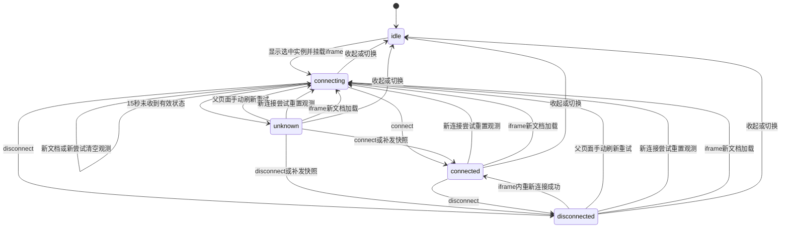
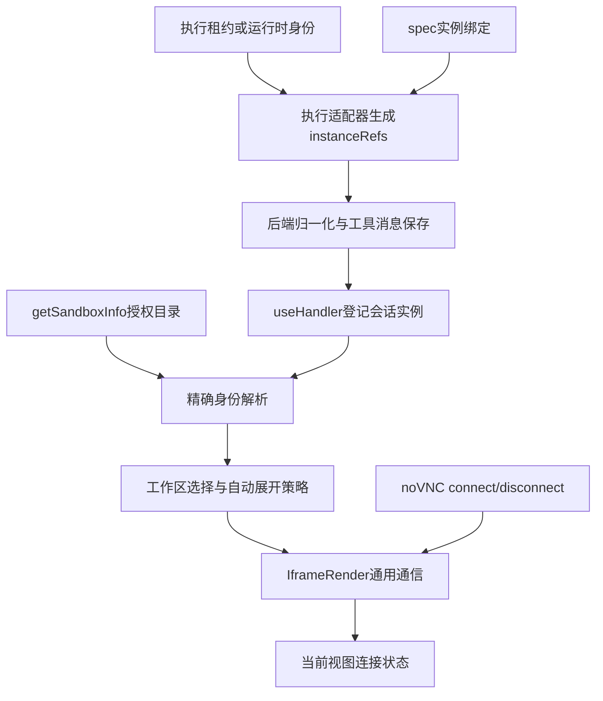
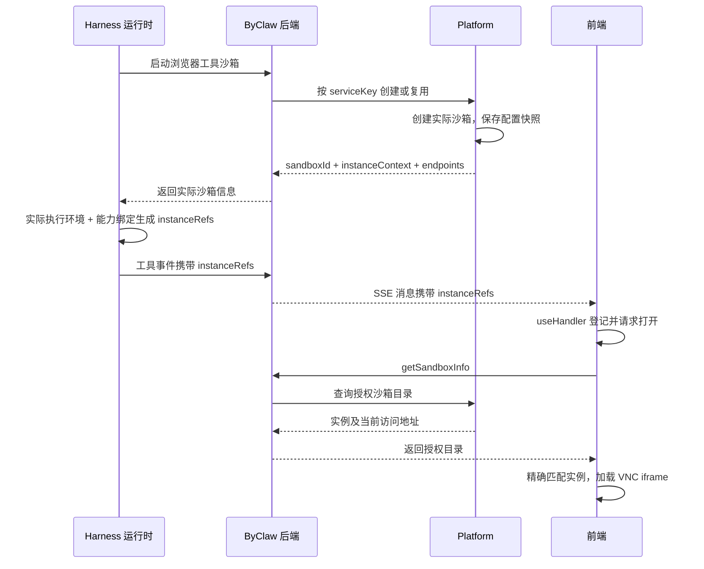
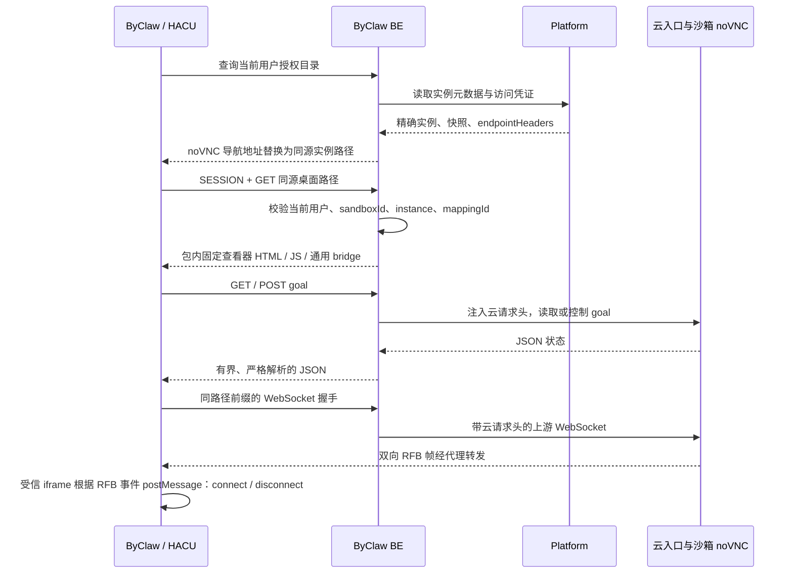

# 多沙箱实例展示与 VNC 连接状态设计

- 日期：2026-11-06
- 状态：已完成实现，本文同步当前契约和实例链路；已完成本轮兼容性复审并修复确认问题，尚未上线或完成真实多沙箱集成验证。
- 实现归属：ByClaw 通用前后端与运行时；交互以 HACU 现有体验为基线。
- 文档范围：多实例工作区、实例引用契约、目标解析、iframe 通信及首版连接状态。
- 本文随功能实现纳入版本管理；示例不写入模板数据库或部署配置。

## 1. 目标与已确认决策

一个用户可以同时拥有 DSH、浏览器工具、编辑器工具等多个沙箱；一个沙箱也可以声明多个桌面端口。一个聊天会话因此可以关联多个桌面，同一个共享桌面也可能被多个会话引用。

本方案将当前“识别浏览器消息后打开一个 URL”改为“工具报告实际实例引用，前端在会话工作区展示多个实例”，并复用现有 iframe 通信展示观看连接状态。

| 决策 | 首版约定 |
| --- | --- |
| 默认实例范围 | 当前会话使用过的实例；允许从“全部桌面”手动添加当前用户有权访问的其他实例 |
| 主要容器 | 一个右侧“远程桌面”工作区，多个实例页签，一次查看一个实例 |
| 自动展开 | 沿用 HACU 每会话首次自动展开、关闭后不反复打扰的体验 |
| 后续实例 | 增加页签和新实例标记，不覆盖当前画面、不抢焦点 |
| 首版状态来源 | noVNC 的 connect / disconnect；由 iframe 通过 postMessage 通知父页面 |
| 状态含义 | 仅描述本次观看连接，不推断远端进程退出、崩溃或任务完成 |
| 实例定位 | 执行层提供通用 instanceRefs；前端按身份解析 getSandboxInfo |
| 地址与凭证 | 访问时从授权实例清单获取；不写入工具引用、聊天历史或界面持久化状态 |
| 通用性 | 引用协议不绑定 VNC；iframe 通信层不认识沙箱、聊天或抽屉业务 |

首版不实现远端进程监控、运行状态订阅、桌面启动/停止/重启、沙箱回收操作，也不新增多画面同时观看或分屏。现有自动化接管策略保持其原有语义；首版无法仅凭断线识别其原因。

## 2. 当前实现与缺口

本节记录方案制定时的基础与待修正行为；当前实现链路见第 8 节，验证结果与边界以交付记录为准。

### 2.1 已有基础

1. getSandboxInfo 返回多个沙箱，包含 sandboxId、sandboxType、isShared、mappingId、status、workerOnline 和 instanceEndpoints。
2. spec.ports 中的 instance 是逻辑入口名称，后端以其为 key 生成 instanceEndpoints。
3. useHandler 已按工具 orderId 合并开始、更新和结果消息。
4. IframeRender 已支持 iframePayload、onMessage，以及父子双向 postMessage 封套；MainDrawer 的 iframe、vnc 类型都复用它。
5. Harness 和 OpenClaw 的 noVNC 页面均已监听 RFB connect / disconnect，并更新自身状态文字和重连按钮。
6. 工具沙箱的 ExecutionLease 已有 leaseId、serviceKey、可选 sandboxId；sandbox_exec 使用 lease_id，执行层可以找到实际运行环境。

本次讨论中实际读取过 getSandboxInfo，得到一个运行中的独占 DSH 沙箱，入口包含 byclaw-harness 和 vnc。该样本的地址为带凭证的独立 HTTPS 入口，不是页面同源路径。这里只记录结构观察，不保存请求凭证、真实用户标识或访问地址；也不据此认定线上所有沙箱形态相同。

### 2.2 必须修正的行为

- getVNCUrl 当前取第一个 RUNNING 且有对应入口的沙箱；多个候选时不能定位本次工具实际使用的桌面。
- 工具名含 browser 或命令含 bycli，只能提示浏览器活动，不能确定实际执行位置。
- sourceAgentType=dsh 描述消息来源，DSH 仍可能通过 SSH 在另一个工具沙箱执行。
- HACU 的自动打开事件和 URL 更新事件分开发送；即使自动打开被拦截，后续 URL 更新仍可能覆盖当前 iframe。
- IframeRender 当前没有实际校验消息 source/origin；多个 iframe 可以互相污染消息消费。
- iframePayload 的去重状态跨文档保留，加载前发送可能导致新文档加载后不再收到初始化。
- noVNC 的旧 RFB 对象可能在重连后迟到地触发 disconnect，覆盖新连接的状态。
- getSandboxInfo 中的 RUNNING、workerOnline 或 HTTP 页面可达，都不能证明 RFB 连接已成功。
- getSandboxInfo 列表可能受缓存、只查询运行中记录及异常返回空列表影响；列表缺项不能证明远端进程退出。

## 3. 实体、身份与状态归属

### 3.1 沙箱实例引用

```ts
type SandboxInstanceRef = {
  sandboxId: string;
  instance: string;
  mappingId?: string;
};
```

- sandboxId 必须采用 getSandboxInfo 中的身份语义，而非任意容器名、内部记录 ID 或模型生成的字符串。
- instance 严格等于 spec.ports[].instance 和 instanceEndpoints 的 key；不靠 URL、端口号、工具名推断。
- 独占沙箱以 sandboxId + instance 定位。
- 平台共享上下文必须携带 mappingId，同时匹配 sandboxId + mappingId + instance。一个物理沙箱可能承载多个用户上下文，不能仅按物理 ID 匹配。
- 旧常驻共享实现如采用用户上下文合成 ID，由后端适配器明确归一化。首版缺少 mappingId 的引用不自动匹配 isShared=true 的候选，避免猜测共享身份。
- 共享执行环境中的内部 sandboxId 可能与清单中的 provider sandboxId 不同，生产引用前必须经租约/映射归一化。

前端实例 key 使用明确的元组编码，例如 JSON.stringify([sandboxId, mappingId ?? null, instance])，避免字符串分隔符碰撞；仓库外层再按当前认证身份隔离。URL、token、端口和当前聊天 ID 都不作为实例主键。

### 3.2 三类状态分别保存

| 状态 | 所属范围 | 首版来源 |
| --- | --- | --- |
| 实例目录及地址 | 当前认证身份 | getSandboxInfo |
| 聊天关联及界面偏好 | 当前身份 + owner | 实时/历史 instanceRefs、用户手动添加和切换 |
| 当前观看连接 | 当前 iframe、channelId 与 attemptId | 本地打开/重连动作、noVNC connect/disconnect |

连接状态不能跨浏览器标签页、跨用户或跨查看窗口共享为“实时状态”。同一远端实例在另一个窗口连通，不代表当前窗口已连接。

owner 采用明确的类型与 ID，聊天场景区分 session、group，非聊天入口使用独立 external owner；外层包括账号和租户。HACU 映射其既有 SurfaceOwner 约定，不只使用裸 chatId。后台消息按消息自身所属会话登记。空 ID 不写入共用默认键；新会话使用局部临时 owner，获得服务端正式 ID 后一次性迁移关联与偏好，自动展示须等待有效会话身份。

## 4. 交互设计

### 4.1 工作区结构

```text
聊天标题                                [远程桌面 3]

┌────────────────────────────────────────────────────────────┐
│ 远程桌面                         全部桌面   全屏   收起      │
├────────────────────────────────────────────────────────────┤
│ 浏览器 · DSH       Unity · 工具沙箱       浏览器 · 采集沙箱   │
├────────────────────────────────────────────────────────────┤
│ Unity · 工具沙箱                             已连接          │
│                                                            │
│                       当前实例画面                          │
│                                                            │
└────────────────────────────────────────────────────────────┘
```

- 实例名称采用“功能名称 · 沙箱名称/类型”；同名来源仍无法区分时补短 ID，完整 ID 与端口放详情。
- 多个端口通过实例名称区分。较少实例直接显示页签，溢出时使用“更多”列表，不强制缩小标签。
- 移动端使用全屏单实例和顶部切换器；状态同时有文字，不只靠颜色区分。
- “全部桌面”按沙箱分组，展示当前身份授权清单中的可识别 noVNC 入口。未知展示类型不自动作为桌面打开。
- 顶部数量表示当前会话已登记且未隐藏的桌面条目数，不表示运行中或已连接数量。
- 聊天标题中的“远程桌面”入口不以已有工具引用、实例数量或是否已打开为显示条件。零实例时仍可进入空态并点击“全部桌面”，查询授权清单后添加；清单为空、加载中、请求失败分别显示空态、进度与重试，避免没有引用就无法发现桌面的循环依赖。

### 4.2 登记、选中、展开是不同操作

工作区提供三个职责明确的动作：登记/更新实例、选择实例、设置面板可见性。后台工具消息首先登记实例，不直接广播裸 URL 覆盖当前面板。

| 事件 | 登记实例 | 改变当前选中项 | 展开工作区 |
| --- | --- | --- | --- |
| 当前会话首次收到有效实时桌面引用 | 是 | 未有用户选择时选择此次首个候选，可替换历史恢复的默认项 | 满足自动展开条件时一次 |
| 后续工具引用新实例 | 是，标“新” | 否 | 否 |
| 用户点击工具消息“查看桌面” | 是 | 是；多个引用先给选择器 | 是 |
| 用户从“全部桌面”添加 | 是 | 是 | 是 |
| 历史消息恢复引用 | 是 | 仅恢复已保存选择或列表默认项 | 否 |
| 后台会话收到迟到消息 | 更新该会话记录 | 不改变当前会话 | 否 |
| 当前连接断开 | 不变 | 不变 | 不自动重新展开 |

自动展开规则：

1. 每个认证身份、owner、浏览器标签页只有一次自动展示机会；采用会话级 store，并在 sessionStorage 保存已处理标记，跨路由切换和刷新保持。
2. 自动展示机会只由当前聊天的新实时工具引用触发；历史回放、恢复快照、重复工具更新不触发。
3. 用户已手动打开或收起过该会话工作区时，视为已处理首次机会。
4. 用户正在查看其他工作面板时不替换该面板，标记此次自动展示机会已处理并提示桌面入口；不在稍后突然补弹。
5. 已知引用但端点暂未出现在清单时，入口显示“正在准备”。端点解析成功后才可创建 iframe；这只表示地址已获得，画面仍显示“连接中”。
6. 等待期间切换 owner、用户主动操作其他面板、收起或手动选择实例，立即取消自动展示资格；实例关联保留。后续工具登记另一个实例不取消首个实例的等待，也不创建第二次自动机会。

机会状态按 owner 原子推进 idle → pending → consumed：首个有效实时候选获得 pending，记录目标引用和请求代次；其余事件只登记。解析成功并且 owner 仍在前台、用户意图未变化时才展开并标记 consumed；超时、取消同样消费机会，保留手动入口。pending 开始即持久化已处理标记，刷新不复活等待任务。目录请求可合并，目标解析按实例/请求分代，不直接沿用单个全局 requestRef 让后续实例取消首次请求。

### 4.3 单画面连接与关闭语义

- 首版只为当前选中且可见的实例挂载 iframe。
- 切换实例、收起工作区或关闭当前视图会使旧 channel 失效并卸载 iframe，只断开本次观看，不停止远端程序或沙箱。
- 后台实例显示“未连接”，详情可保留“上次已连接/连接中断”的时间，不能继续显示实时“已连接”。
- 主动关闭造成的断连不产生异常提醒，不触发自动重开。
- 全屏与停靠切换优先保留同一个 iframe；如现有宿主必须重挂载，按照新连接处理并创建新 channel，不伪装连接连续。全屏必须承载同一工作区/展示适配器并保留 owner 与选中项，不能将 vnc 类型原样转给当前只处理 iframe 的 FullscreenModal 分支。
- 关闭某个页签将其在本会话隐藏，关联记录仍保留；重复工具事件不强行重新显示，被隐藏实例可从选择器或工具消息重新打开。
- 保留 noVNC 已有重新连接按钮；父页面工具栏始终提供“重新连接”，用于旧镜像、代理错误页、加载超时或子页面脚本失败时恢复。该动作重新解析当前引用的授权地址，作废旧请求/channel，再挂载一次 iframe，不调用远端重启接口；有授权错误时先显示登录/权限提示。
- 首版不增加强制抢占、自动发送控制输入或断线后无限重连。只读/控制和人工接管继续由现有 noVNC/自动化策略决定；“已连接”不等于已经获得控制权。

### 4.4 会话记录与恢复

工具来源关联随工具消息的 instanceRefs 保存，历史消息加载后恢复。手动添加、隐藏、最后选择项、面板偏好及首次机会标记只在当前认证身份的 sessionStorage 保存；首版不新增跨设备同步。

不持久化 URL、token、endpointHeaders、实时 connected 状态或 channelId。刷新后重新获取清单并建立新连接。注销、账号/租户切换清理相应内存与本地偏好。

目录缓存及在途 Promise 必须绑定认证代次 authEpoch；切换身份时递增代次、清空目录、卸载旧 iframe，并取消能够取消的请求。无法取消的旧 Promise 即使成功也不得写入新身份缓存或打开面板。请求完成同时核对身份、所属会话、当前请求代次，不能只比较是否仍为同一个 Promise。

### 4.5 保留非聊天桌面入口

运营账号扫码登录等入口已有 MainDrawer 裸 URL、overlay、title、导航与登录确认流程，未携带聊天 ID。这些调用使用独立 external owner，不自动登记到当前聊天，也不受聊天的一次展开限制。打开访问目标仍由原业务的沙箱选择结果决定，确认登录必须使用同一个 sandboxId。

工作区宿主增加原子打开请求与返回的视图句柄，承载 owner、内容和展示参数；所有现有 VNC 的打开/URL 更新/关闭生产者都经兼容适配器接入。晚到更新和关闭只作用于同 owner、同句柄代次，不能覆盖或关闭后来打开的聊天桌面/文件。原有非 VNC 抽屉事件保持原约定；无 owner 的旧 URL 事件不能写入新聊天工作区。上线前逐个迁移已知 VNC 生产者，不能只修改消费者后期待拆开发送的旧事件自行获得身份。

录制器的 VncFrame 继续使用其独立原生 iframe 与录制生命周期，本次不改变录制绑定、停止、外部/托管来源的语义。观看连接断开不能被映射为停止录制。

## 5. 工具消息契约及引用来源

### 5.1 使用 content.instanceRefs

```json
{
  "content": {
    "orderId": "tool-123",
    "instanceRefs": [
      { "sandboxId": "sandbox-B", "instance": "browser-desktop" },
      { "sandboxId": "sandbox-C", "instance": "editor-desktop" }
    ]
  }
}
```

上述是已有工具消息的新增字段片段，其余内容字段保持原约定。instanceRefs 表示“本次工具调用实际关联、可供用户查看的实例”，并非用户全部可用入口，也不是要求前端立即打开的命令。

- 数组支持一次工具调用关联多个实例，复用 content.orderId，不另造 toolCallId。
- 放在单条工具消息 content 中，不占用已有 resourceList、resComIds 或整条回答级 metadata。
- 不包含 URL、token、原始请求头、HTML、端口或 autoOpen 指令。
- 字段缺失表示旧消息或目标尚未明确；只有合并后的工具消息仍缺失该字段，才允许旧工具名识别兜底。新适配器尚未确定目标时应显式给空数组，之后再补充引用，避免被旧逻辑抢先选错。
- 显式空数组表示本帧没有可展示目标，不清除已登记引用，也不触发旧工具名自动打开；有明确但非 noVNC 的引用同样不回退到其他桌面。非法字段不能被当作缺失而触发兜底。
- 同一 orderId 的增量更新按规范化身份做集合合并，保持首次出现顺序；工具结果可以补充开始阶段未知的实例。
- 来源必须是执行适配层生成的结构化元数据，不能直接信任模型参数、任意 stdout 或网页内容中的同名对象。

### 5.2 sandboxId 的取得

```text
沙箱申请/路由响应
  → 实际执行运行时身份
  → ExecutionLease / 共享上下文映射
  → 按租约找到实际目标
  → 归一化为 getSandboxInfo 的 sandboxId、mappingId
```

工具沙箱复用 sandbox_acquire 返回的租约和 sandbox_exec 的 lease_id。原生浏览器或本地工具由实际运行时适配器提供身份；DSH 的消息来源字段不能替代执行目标身份。

ExecutionLease.sandboxId 当前可选。无法取得并归一化身份时不生成不完整引用，保留人工选择入口；不拿 serviceKey、内部数据库记录 ID 或列表首项充当 sandboxId。

### 5.3 instance 的取得与模板配置

spec.ports 声明可访问入口；执行适配器知道本次使用的能力。新增可选展示描述和能力绑定，将两者连接起来。下列可选字段已在当前实现中接入：

```json
{
  "ports": [
    {
      "port": 8081,
      "instance": "browser-desktop",
      "protocol": "http",
      "presentation": { "viewer": "novnc", "label": "浏览器" }
    },
    {
      "port": 8082,
      "instance": "editor-desktop",
      "protocol": "http",
      "presentation": { "viewer": "novnc", "label": "编辑器" }
    }
  ],
  "instanceBindings": {
    "browser.automation": ["browser-desktop"],
    "editor.interaction": ["editor-desktop"]
  }
}
```

- instanceBindings 的 key 是执行适配器声明的稳定能力标识；值是该能力关联的实例名数组。
- browser.automation 与专用编辑器能力由适配器明确报告，不从任意 Shell argv 猜测。
- 为单一用途模板允许显式配置保留 key default，作为未细分能力的展示绑定；它是模板作者的明确声明，不根据“只有一个端口”自动生成。通用 Shell 模板默认不配置它。
- 解析优先级：具体能力绑定 → 显式 default → 不产生引用。
- 多个有歧义的入口且没有绑定时，展示可选实例，不自动选择。
- 新增或修改展示绑定时校验 instance 在该 spec 中唯一、绑定目标存在、端口合法；校验失败阻止该配置发布，不静默退回另一个实例。旧模板缺少新增字段仍按原逻辑加载。运行时遇到缺失或损坏的可选展示元数据时，仅禁用该目标的展示引用并记录诊断，不因此中断原有工具执行或拒绝启动沙箱；原有必需字段校验保持不变。
- 适配器绑定与模板能力保持一致。实例清单里存在某入口不等于某工具实际使用过它。

### 5.4 绑定元数据进入执行层的路径

绑定和展示描述以实际运行沙箱创建时生效的 spec 为准，并随该运行实例保留配置快照。模板后续发布只影响新建实例，不能用最新模板重新解释旧镜像中的端口。

提供沙箱的控制面在分配/获取响应中增加可选 instanceContext，包含规范化 sandboxId、mappingId（适用时）、instanceBindings 和 instanceDescriptors。这份数据不含访问凭证；来自当前运行实例的配置快照，而非工具参数。

```text
实际运行实例的spec快照
  → 所属控制面的分配/获取响应.instanceContext
  → ByClaw BE及运行时provider适配层保留字段
  → 内部执行句柄/租约保存可信上下文
  → 工具适配器按本次能力读取绑定
  → 生成content.instanceRefs
```

执行层保留内部上下文即可，不要求把完整绑定都展示在模型可见的工具结果中。当前实现由 provider 的分配响应读取 instanceContext，实际执行句柄/ExecutionLease 保留该上下文，工具适配器按能力读取；运行时不直接读取 BE 的模板对象。上下文缺失时不生成猜测引用，保留明确的人工选择与旧入口兼容。

快照必须能跨服务重启恢复，不能只存在内存或目录缓存中：

- ByClaw 本地独占路径在 SsSandboxRecord 增加可空 instance_context_snapshot TEXT 字段，保存版本、绑定和展示描述；创建时由可信 spec 一次生成，随运行记录保存。地址、token 和请求头不进入快照。旧记录为 NULL，按旧入口约定处理，不用当前模板补造快照。
- 平台提供的实例由平台控制面持久化并投影。共享快照复用已有 `SharedPoolInstance.launch.instanceContext` 持久 payload；成员从该宿主快照投影其获授权入口。按本次用户确认的最小化范围，不在 SharedPoolInstance/SharedPoolMember 增加重复顶层快照或通用未知字段容器。独占平台提供者以运行记录承载同一版本化快照，未实现的提供者按旧协议降级，不能宣称精确引用已覆盖。
- 现有 endpoint 字段是扁平地址映射，不能塞入嵌套快照；不要用修改其格式绕过迁移。用户已指定迁移版本 0.6.0，迁移位于 deploy/migrations/versions/V0.6.0/V0.6.0__ddl.sql。版本已被标记 applied 不等于本次新增列已执行，发布前必须确认实际列存在；不修改 initdb 或 .applied。

### 5.5 目标必须在执行过程中上报

byclaw-integration 当前会先投影 tool/call，再执行具体适配器。因此不能只在 sandbox_exec/browser 工具返回结果时补引用；需要覆盖三个阶段：

1. 新适配器通过可信注册元数据声明支持引用契约。集成层在首次 tool/call 投影前为这类调用写入 instanceRefs: []，即使还没有目标，也阻止新前端旧工具名兜底。未知的旧适配器仍保持字段缺失。
2. 执行路由/租约确定后、开始长任务或等待人工操作前，适配器通过内部回调报告 instanceRefs。集成层立即产生同一调用的元数据增量，不新增工具调用、不等待结果。长时间阻塞的扫码或编辑器任务也能在进行中打开正确桌面。一次调用再关联其他实例时重复此动作；实际目标尚未确定不能提前猜测。
3. 结果、异常和取消收尾保留已确认引用。后补引用补进同一调用；调用已终结的迟到重复报告不创建新回答，也不重新自动展开。

内部上报采用 Cordis 的插件事件，由运行时集成层写入已有 ByClawSessionMetadataStore 的插件自有存储域，按实际 DSH session ID、session header.createdAt、callId 与对应工具调用事件的 sourceCallSeq 隔离。同一 callId 在后续轮次复用时，引用与终态仍绑定原调用；执行器首次上报即固定调用序号，迟到回调不能重新绑定下一轮。sourceCallSeq 仅为运行时内部关联字段，外部 SandboxInstanceRef 契约不变。可选引用记录在业务读写边界校验，合法 JSON 内的损坏记录降级缺失，不能阻止原会话 roots 加载；roots 的严格校验保持不变。引用保留到恢复/重放，但不能把未注册的自定义事件直接 append 到 DSH 会话日志：当前框架的真实持久化读取校验器会拒绝未标记 ignorable 的未知事件，Session.append 又没有公开的 ignorable 写入口。使用插件自有元数据表避免污染原会话日志，不修改 SDK 的已知事件集合，也不向原工具 stdout 写展示协议。

对外沿用既有 3015 工具更新消息的有效载体，保持调用 ID 与当前状态，用合法的工具内容增量承载更新；不得发送会被 MessageContext 因空 choices 丢弃的裸引用对象。元数据增量不能把工具的执行中状态改成成功，不能覆盖 input/output、流序号、思考内容或原有错误信息。展示信息的读取/上报失败不能替代实际工具错误；观察引用不能额外等待或触发 SSH provider 分配。浏览器操作前读取已知引用，在实际浏览器会话打开后通过调用范围内的观察回调及时补充目标，操作结束（含失败）后兜底读取；首次 runGoal 自行打开浏览器时也在长任务完成前报告目标。

### 5.6 三层消息形态及合并

| 层次 | 新字段位置 | 合并要求 |
| --- | --- | --- |
| 执行适配器 → 运行时集成 | 可信结构化工具元数据 instanceRefs | 由执行回调设置，绑定真实调用 ID |
| 运行时投影 → BE AnswerDelta | AnswerDelta 根级 instanceRefs，与 objectType 等字段同层 | 不塞进现有 content 字符串；该字符串最终用于 substance |
| BE 保存/发送 → FE 工具消息 | message.content.instanceRefs | 与 content.orderId 同层，得到第 5.1 节形态 |

调用键按所属会话/回答与既有归一化 orderId 隔离。后端 MessageContext.updateExistingSegment、流式快照、持久化和历史重建，以及前端 mergeUpdatableMessage，都执行同一语义：保留字段存在性，按规范化身份做稳定集合并集；缺失更新不覆盖已有字段，显式空数组不删除已知引用。非法新字段记录诊断并归一化为无可用引用的显式值，不能当成旧协议缺失而触发猜测。采用独立的引用字段合并，不改变其他字段现有的增量合并优先级。

## 6. getSandboxInfo 的复用与扩展

继续使用现有用户授权沙箱清单，保留 endpoints、instanceEndpoints 和其他已有字段。新增可选 instanceDescriptors，由实际运行实例的 spec.ports[].presentation 配置快照规范化生成：

```json
{
  "sandboxId": "sandbox-B",
  "status": "RUNNING",
  "isShared": false,
  "instanceEndpoints": {
    "browser-desktop": "<访问时返回的授权地址>"
  },
  "instanceDescriptors": {
    "browser-desktop": { "viewer": "novnc", "label": "浏览器" }
  }
}
```

viewer 是前端已注册的展示适配器名称，首版实现 novnc；普通 web 入口保留既有 iframe 使用方式，不因被引用而自动占用桌面工作区。未知 viewer 可列为不支持的入口，不加载动态代码。

旧配置没有描述时，兼容已建立的 vnc、desktop 入口约定为 novnc；不能把所有 HTTP 端口或包含 vnc 字样的任意名称都视为桌面。

解析规则：

1. 用规范化引用精确匹配当前认证身份的清单行及实例 key；共享映射必须完整匹配。
2. URL、endpointHeaders 等访问数据只从授权清单取得，不接受工具事件自带地址。iframe 导航不能任意附加请求头；首版直接嵌入只接入现有完整授权 URL 或可用的 Cookie/代理入口。必须附加 endpointHeaders 才能访问的来源，需要由受控服务端访问适配器换成可导航入口，适配未就绪时明确提示不支持，不静默丢弃鉴权头，也不通过 postMessage 传递凭证。
3. 完整保留地址的 host、path 和查询凭证；URL 处理集中在对应访问适配器，仅对明确的代理目录规则补尾斜杠，不给 vnc.html 等文件路径追加斜杠。保留服务器提供的 sessionId 等路由参数，不能用聊天 ID 替换。首版身份粒度为 spec 入口，不承诺为同一端口下每个浏览器租约额外隔离桌面。
4. 明确目标暂时缺失时，复用现有端点刷新预算（最多 30 次、间隔 2 秒），显示“正在准备”；成功获取目录后仍无该身份，预算耗尽显示“实例不可用”，说明可能已释放或不再授权，可手动从“全部桌面”选择其他实例。目录中有该身份但入口未就绪时显示“暂时无法获取访问入口”。保留旧引用与页签，不自动改选其他沙箱。
5. 保留已关联条目。清单请求失败、返回空数组或某行消失都不能将其标记为“已退出”。
6. HTTP 暖机与 RFB 连接确认分开：现有入口若具备可靠的同源或已授权 CORS 响应，可保留访问适配器中最多 30 次、间隔 2 秒的有界准备等待，对明确的临时 5xx 重试；401/403 提示鉴权问题，不当作可用。该等待只优化首次页面加载，不等于已连接。对不可可靠读取 HTTP 的跨域入口，不以 fetch/CORS 成败或不透明响应阻止 iframe 加载。地址存在但代理尚未准备好时仍可能先显示错误页：外层保留当前目标、超时提示与“重新连接”，重试重新取地址并重新加载；不因没有状态事件而自动循环刷新可能仍可用的旧页面。连接证据统一来自 iframe 事件。
7. 访问凭证更新只更新当前实例的访问数据，实例身份不变；重连或重新打开时使用最新地址。

端点解析与 HTTP 暖机共用本次打开的 60 秒总预算，各自最多 30 次、间隔 2 秒；单次请求设不超过 5 秒且不超过剩余预算的超时。下次调度不得超过截止时间，截止后不再发起请求；已有成功目录结果时，总预算耗尽不能误报“清单获取失败”，真实目录请求失败仍保留失败提示与重试。用户取消、切换 owner 或请求被手动重试取代时停止本次等待；共用目录请求只撤销本次订阅，不中断其他实例的合法等待。任一预算耗尽即退出准备态，提供手动重试，不能因一次请求永久 pending 而一直显示“正在准备”。后续 iframe 的 15 秒状态提示预算按第 7.2 节单独处理。

目录投影需要覆盖实际提供者：本地管理路径由 ByClaw BE 生成描述；platformRemote 路径由平台控制面返回并经 BE DTO 透传；共享路径同时覆盖平台的上下文端点投影和 SharedSandboxGateway 转换。旧平台响应缺描述时按旧入口规则降级。共享上下文没有授权的桌面端点时，不得从物理 host 的 spec 额外补出桌面地址；新增共享桌面能力必须先具备对应的上下文路由与授权。

## 7. iframe 连接事件协议

### 7.1 复用现有封套

父页面仍通过 IframeRender.iframePayload 发送 beyond-iframe-payload，在 data 中加入可选 bridge 字段：

```json
{
  "type": "beyond-iframe-payload",
  "data": {
    "bridge": { "version": 1, "channelId": "view-document-unique-id" }
  }
}
```

子页面沿用 beyond-iframe-receive-payload，内层兼容已有 onMessage({ type, data })：

```json
{
  "type": "beyond-iframe-receive-payload",
  "data": {
    "type": "connection-state-change",
    "data": {
      "version": 1,
      "channelId": "view-document-unique-id",
      "attemptId": 2,
      "state": "disconnected",
      "clean": false
    }
  }
}
```

state 首版只允许 connected、disconnected；clean 为断线事件的可选原始标志。不携带业务身份、凭证或根据异常字符串猜测出的远端退出原因。

另增加 connection-observation-reset 控制消息，复用同一子页面封套，内层 data 为 version、channelId、attemptId，不带 state。attemptId 是当前子文档内单调递增的连接尝试序号。noVNC 在开始新 connect() 时重置观测并通知父页面；这是本地查看连接的控制通知，不是新增 RFB 事件监听或远端进程状态。否则子页面重连时只过滤旧 disconnect，父页面可能永久保留旧 connected。只有真实 connect/disconnect 能确认连接结果。

父业务组件创建回调时绑定当前 SandboxInstanceRef，只有通过通用组件验证的消息才更新该实例。本协议亦可供终端等有连接语义的页面复用；普通预览页不必实现该扩展。

### 7.2 握手、来源与竞态

1. 父组件先安装监听，再赋 src/开始挂载；此时即进入 connecting 并启动 15 秒提示预算，不能等 onload 才计时。每次 iframe 新文档 load 轮换 channelId、清空当前观测并强制初始化，不能被旧 lastPayloadRef 去重拦截。统一为一个 load 入口，移除 native once-listener 与 React onLoad 的重复调用；一个 load 只能产生一个新 channel。URL 切换/卸载立即使旧 channel 失效。
2. 桌面桥接默认可信 origin 只有解析后的 iframe URL origin。确需跨 origin 跳转时，由调用方提供有限可信 origin 列表；load 后对列表中每个明确的 targetOrigin 各发送同一初始化，只有与实际文档 origin 匹配的消息会被浏览器投递。收到首个有效控制/状态消息后绑定当前实际 origin；不根据未知来信扩展允许列表，也不使用星号目标兜底。
3. 子页面在首次 connect() 之前同步安装桥接监听，只接受 window.parent 发来的合法初始化，记录其 origin，并向该具体 origin 回复。独立打开 noVNC 页面时，无父宿主握手也保留原功能。
4. noVNC 开始新 connect() 时递增 attemptId、清空快照，已经握手则先发 observation-reset，再创建 RFB；真实回调只记录/发送当前 attempt 的状态。收到初始化时回复当前 attempt 的 reset，再补发该代已有的最近真实状态，这一回复同时作为握手确认；没有真实事件时不沿用上一代 connected。握手前的状态仅在子页面内暂存，无宿主时不向外广播。
5. 父页面同时校验 event.source 等于该 iframe.contentWindow、origin 可信、封套/字段类型正确、version 为 1、channelId 为当前文档以及 attemptId 为合法非负整数。新的 attempt 使当前观测失效；当前文档首次采纳 attempt（含首次握手 reset）沿用导航已开始的预算，已超时则保留 unknown。仅绑定该文档之后实际发生下一次 connect() 尝试或用户显式刷新时，才进入 connecting 并启动新预算。旧 attempt 全部忽略，同一 attempt 的重复 reset/初始化不清掉已确认状态、不重置超时。第一条合法状态可以确立该 attempt，防止丢失 reset 后无法收敛。
6. noVNC 每次 connect() 的回调捕获本次 RFB 对象或连接序号；旧对象的延迟 disconnect 不更新页面也不上报。
7. 父页面 load 后立即发送初始化，未确认时在约 250 毫秒、1 秒、3 秒有限重发同一 channel 的初始化，确认后停止；只重发消息，不刷新文档。提示预算从本次导航/观看尝试开始，同一次尚未确认的加载过程出现多个 load、重定向或握手重试，不无限延期。已经建立观测后的自刷新以及新的显式连接尝试启动新预算。超过预算仍接受有效事件。
8. 重复状态按 channel + attempt + 状态内容去重，不重复提示。通信初始化不计为工具使用，也不重新触发自动展开。
9. 连接桥接由桌面调用方显式启用，未启用时不注入 bridge、不要求 channel、不对普通预览设置连接超时。原有业务 payload、onMessage({type,data}) 与 iframe-set-height 保持约定；只对连接协议分支消费新增字段，未知扩展不能吞掉已有业务事件。

通用 IframeRender 仍承担直接子窗口 source 验证及负载类型校验；origin 策略由地址类型与调用方显式配置决定。HTTP(S) 与 blob 使用可确定的实际 origin，about:blank/srcdoc 按继承的创建者 origin 处理，不能直接将 URL.origin 的 null 当作信任依据。确有 opaque-origin 页面时，仅在原有调用方显式启用的兼容配置下按精确 source 接受其非敏感旧协议消息，不能将 null 加入全局可信列表；这类配置不启用桌面连接桥接。嵌套页面应由直接子页中继。

自动高度继续保留“当前文档 load 前已有显式高度则优先使用”的行为；新文档的 payload 重发不能覆盖高度选择、重复执行 onLoad 或丢失普通 HTML/blob 预览回调。上述校验须覆盖现有调用方测试，不能用桌面握手要求替换整个通用 iframe 协议。

### 7.3 前端状态机



| 本地状态 | 文案 | 依据 |
| --- | --- | --- |
| idle | 未连接 | 当前没有挂载观看连接 |
| connecting | 连接中 | 已发起查看，等待有效事件 |
| connected | 已连接 | 当前 channel、attempt 收到 connect |
| disconnected，clean=true | 已断开 | 收到正常断连标志；原因不作进一步推断 |
| disconnected，clean=false | 连接中断 | 收到异常断连标志；不表示远端崩溃 |
| disconnected，clean 未提供 | 已断开 | 只知道连接结束 |
| unknown | 连接状态未上报 | 超过 15 秒没有有效事件；页面可能仍可使用 |

15 秒只是提示等待上限，不销毁 iframe、不认定失败；之后的有效事件仍会更新状态。iframe.onload 只用于文档初始化，不作为 RFB 连通证据。旧 noVNC 镜像、iframe 一直不触发 load、加载到错误页、构造 RFB 时抛错但未发 disconnect，均可能进入 unknown；保留 iframe 原有提示和父页面重试入口。超时结束只解除父页面的等待遮罩，不能持续盖住可能仍可使用的画面；之后收到 load/有效状态继续正常处理。

收起后的后台条目不再显示实时状态，也不持续保留实时异常计数；可在详情查看上次观测。前端不新增周期性后台 VNC 探测。

## 8. 端到端数据流与模块责任

### 8.1 总体责任



| 模块 | 责任 | 不承担的责任 |
| --- | --- | --- |
| 运行时/工具适配器 | 找到实际沙箱、能力绑定与实例引用 | 决定前端弹窗、传递访问凭证 |
| 后端消息链路 | 校验/归一化引用，透传并保存到对应工具 | 根据工具名称猜桌面 |
| 沙箱目录解析层 | 取得最新授权地址、描述、匹配共享上下文 | 把清单缺项判定为退出 |
| useHandler | 消费合并后工具引用，登记会话关联 | 管理多个 RFB 或直接替换当前 URL |
| 工作区/store | 实例页签、选中、可见性、一次展开规则 | 远端进程生命周期 |
| IframeRender/通用 hook | 消息来源验证、文档 channel、连接事件分发 | 理解 sandboxId、会话或 VNC 专用路由 |
| noVNC 适配器 | 将原有 RFB 事件转成通用事件 | 推断进程退出、上传敏感 URL |

后端不能只在 SSE 最外层增加字段：需要覆盖运行时事件、AnswerDelta、MessageContext 工具片段合并、工具消息 content 构建、持久化/历史恢复、流式快照及重放，按第 5.6 节保持字段层级和存在性。FE 的 mergeUpdatableMessage 必须显式合并 instanceRefs，避免现有旧 content 覆盖新 content 的顺序丢掉后补引用。

HACU 中持久定制写入 hacu-fe/extensions，相应源码继承并适配 ByClaw 通用能力，不直接修改生成目录。工作区可借鉴 HACU 现有页签、全屏和 owner 隔离语义，但首版不迁移整个文件预览体系。

### 8.2 具体示例：浏览器工具打开自己的 VNC

以下采用 `byclaw.platform.execution-mode=remote` 的独占工具沙箱。ID、模板名及地址都是示例，不代表实际部署值。当前用户拥有三个沙箱，本次浏览器操作实际发生在第二个：

| sandboxId | 用途 | 桌面实例名 |
| --- | --- | --- |
| sbx-dsh-001 | 运行 Agent | vnc |
| sbx-browser-017 | 执行本次浏览器操作 | browser-ui |
| sbx-editor-008 | 编辑器工具 | editor-ui |

目标是打开 `sbx-browser-017` 的 `browser-ui`，不能从消息来源是 DSH 就选择第一个沙箱。



**模板配置。** 假设注册记录的 serviceKey 是 `tool-browser-demo`。下面仅展示 specJson 的相关片段，镜像、启动、挂载和工具准入配置沿用已有有效模板；镜像必须真实提供 2222 的 SSH 和 8081 的 noVNC 服务。serviceKey 不放在这个配置片段中。

```json
{
  "ports": [
    {
      "port": 2222,
      "instance": "ssh",
      "protocol": "tcp",
      "exposure": "private"
    },
    {
      "port": 8081,
      "instance": "browser-ui",
      "protocol": "http",
      "presentation": {
        "viewer": "novnc",
        "label": "浏览器桌面"
      }
    }
  ],
  "instanceBindings": {
    "browser.automation": ["browser-ui"],
    "default": ["browser-ui"]
  }
}
```

- `instance` 给端口一个逻辑名称；它是后续 instanceEndpoints 和引用中的同一个 key。
- `presentation.viewer` 告诉前端可用何种方式展示；当前桌面工作区接入 novnc。
- `browser.automation` 是浏览器适配器明确查询的能力；`default` 是本模板为未细分能力的工具操作声明的默认绑定，不代表系统从 Shell 命令推断出浏览器操作。
- specJson 不包含 sandboxId。它描述模板；实际沙箱 ID 要从可信创建/复用结果取得。

**Platform 创建与快照。** 运行时通过 ByClaw `/sandbox/launchByUserCode` 申请模板。remote 模式下，BE 调用 Platform 的 launch 服务，Platform 向 provider 创建或复用实际沙箱。若本次新建得到 `sbx-browser-017`，创建时配置生成版本化快照；记录生命周期将快照与启动成功状态在同一次 CAS 更新中保存。恢复时补上实际 ID，并按授权端口名裁剪，形成下列 instanceContext：

```json
{
  "version": 1,
  "sandboxId": "sbx-browser-017",
  "instanceBindings": {
    "browser.automation": ["browser-ui"],
    "default": ["browser-ui"]
  },
  "instanceDescriptors": {
    "browser-ui": {
      "viewer": "novnc",
      "label": "浏览器桌面"
    }
  }
}
```

模板后续修改不会重新解释这个运行实例。复用有快照的记录时恢复创建快照；旧记录无快照时保持 legacy，不按当前模板补造。这个快照不保存 URL、token 或请求头。

**ByClaw 后端与运行时 provider。** 本例由 Platform 保存沙箱记录；BE 负责业务入口、鉴权、远程调用及新字段传递，不重复创建沙箱。启动响应同时携带 sandboxId、instanceEndpoints、instanceContext 和 instanceDescriptors。运行时 `ByClawBeBackend` 将响应的 instanceContext 绑定到实际 SSH 执行环境；需要目录补全时，只有已知真实 sandboxId 才能从精确匹配的条目补充上下文，不能用列表首项确认展示目标。

**运行时产生引用。** 浏览器插件在实际 SSH 执行环境已经存在时查询 `browser.automation`，等价于：

```ts
instanceRefsFor(instanceContext, 'browser.automation');
```

结果为：

```json
[
  {
    "sandboxId": "sbx-browser-017",
    "instance": "browser-ui"
  }
]
```

| 字段 | 来源 |
| --- | --- |
| sandboxId | 实际执行环境的 instanceContext.sandboxId |
| instance | instanceContext.instanceBindings 中具体能力或 default 的绑定 |
| mappingId | 适用时由控制面返回的共享映射身份；本独占示例不携带 |

普通 sandbox_acquire/sandbox_exec 从本次真实租约读取同一上下文，未指定能力时查询 default。新适配器首先声明空引用，实际路由确定后经带实际 session、callId 和固定 sourceCallSeq 的 Cordis `byclaw/tool-instance-refs` 事件上报，集成层在插件自有元数据存储中保存并及时投影到同一工具调用；该事件不写入 DSH 会话事件日志。已分配的长任务可在执行前报告目标；首次 runGoal 内部新建浏览器时，在真实 open 完成、长目标执行前回调上报。展示读取不等待或触发 SSH ready，不改变 close、连接分配及业务错误。模型不需要填写这些身份字段。

**流式消息层级。** 运行时集成层把引用写在 AnswerDelta 根字段，不再在工具内容 JSON 中复制一份。下列是省略 choices 等原有必需字段后的消息片段，不能作为完整事件直接发送：

```json
{
  "contentType": "3015",
  "orderId": "tool-call-123",
  "instanceRefs": [
    {
      "sandboxId": "sbx-browser-017",
      "instance": "browser-ui"
    }
  ]
}
```

BE 接收、合并和保存引用，前端 SSE 转换层映射到 `sseRes.message.content.instanceRefs`。历史恢复及工具结果帧继续保留该集合。

**useHandler 的决策。** 它从合并后的工具消息拿到引用，先登记到该消息所属会话；只有当前会话才考虑自动打开。调用形态如下，省略前置校验：

```ts
openVnc({
  key: `${answerId}:${toolId}`,
  instanceRefs: [
    { sandboxId: 'sbx-browser-017', instance: 'browser-ui' },
  ],
});
```

useVncOpener 仍负责首次自动打开、会话归属、异步取消及不抢占其他面板的规则。useHandler 知道目标身份，但不掌握访问 URL，也不从 specJson 解析端口。

**授权目录解析与显示。** useVncOpener/工作区查询既有 getSandboxInfo；remote 模式下 BE 查询 Platform info 服务，再返回用户授权的实例目录。下列是其中一项的关键字段；示例地址仅说明映射关系，实际地址、代理路径及临时鉴权参数以接口返回为准：

```json
{
  "sandboxId": "sbx-browser-017",
  "sandboxType": "tool-browser-demo",
  "status": "RUNNING",
  "instanceEndpoints": {
    "browser-ui": "https://desktop.example/sbx-browser-017/8081/"
  },
  "instanceDescriptors": {
    "browser-ui": {
      "viewer": "novnc",
      "label": "浏览器桌面"
    }
  }
}
```

前端精确匹配 sandboxId、可选 mappingId 和 instance。等价的定位逻辑是：

```ts
const row = rows.find(
  (item) => item.sandboxId === ref.sandboxId
    && (item.mappingId ?? null) === (ref.mappingId ?? null)
);
const url = row?.instanceEndpoints?.[ref.instance];
```

实际 resolveDesktop 还会检查展示类型、共享映射完整性、HTTP(S) 地址及请求头鉴权限制。本例最终选择 `sbx-browser-017 → browser-ui → 8081`，加载服务端返回的可导航地址，而不是拼接一个猜测 URL。需要额外请求头的入口须先由服务端提供可导航方式。

页面加载后，noVNC 的 connect/disconnect 经共享桥接发给父 iframe 通信层，更新“已连接/已断开/连接中断”；iframe load 或工具完成本身都不等于 VNC 连接状态。

### 8.3 示例的兼容与模式边界

| 情况 | 当前处理 |
| --- | --- |
| 有有效 instanceRefs | 精确定位；找不到时等待或提示，不改选其他沙箱 |
| 显式 instanceRefs: [] | 本帧无可关联目标，不启动旧工具名推断；不清除同调用已登记引用 |
| 完全缺少 instanceRefs | 旧消息兼容；唯一候选可打开，多个候选提供人工选择 |
| 本地 legacy 控制面 | 由 ByClaw BE 自身生命周期保存/恢复同契约，不经过 Platform；请求级工具 SSH 密钥启动仍按原约束要求 remote |
| 共享 DSH 宿主 | 引用必须携带精确 mappingId，并按成员授权入口过滤；当前成员只开放 byclaw-dsh，不能把宿主 VNC 当成本例工具桌面 |
| 模板更新或旧记录没有快照 | 不用新模板推断旧实例；无真实快照保持旧入口兼容 |

目标身份来自实际执行环境；访问地址来自当前授权目录。这两个来源分离，使地址变化、凭证刷新或多个沙箱同名实例不会改变工具的关联身份。

## 9. 兼容与异常处理

| 情况 | 首版处理 |
| --- | --- |
| 合并后工具消息缺失 instanceRefs | 保留原浏览器活动识别；唯一候选可兼容打开，但不记录为已确认的工具目标；多个候选显示选择器 |
| 显式空数组或明确非桌面引用 | 不触发旧工具名兜底，不清除已经登记的引用 |
| 引用已知但目录暂无目标 | 等待并刷新目录；不改选其他沙箱 |
| 非法引用/未经授权目标 | 不解析任意地址，不自动打开；显示不可用并记录安全的诊断代码 |
| 共享引用缺失或不匹配 mappingId | 不自动选共享 host 的其他上下文 |
| 工具开始时未知，结果才补引用 | 按 orderId 合并后登记；受当前会话/一次展示规则约束 |
| 已升级工具仍在执行/等待扫码 | 在实际目标确定后立即发布同调用元数据增量，无须等待结果；结果补发只作兜底 |
| 新前端配旧 noVNC | 页面照常显示；外层连接状态未上报，不强制失败 |
| 旧前端配新 noVNC | noVNC 无握手时保持原操作与 UI |
| iframe 跨域 | 使用 postMessage 与明确 origin，不能直接访问子页面 DOM |
| 旧 noVNC 使用全局 novncUrl Cookie | 多实例路径使用页面自身完整地址及相对 WebSocket 路径；不依赖全局 Cookie 选择目标。只保留独立的旧调用兼容，不让多个视图共享 Cookie 路由 |
| 连接因自动化控制策略断开 | 按实际 clean 标志显示已断开或连接中断；不推断自动化原因，不改变现有接管实现 |
| 页面/地址更新后收到旧事件 | 旧 channel/RFB 回调直接忽略 |
| 租约结束或任务完成 | 不转换为 VNC 已退出；执行资源可能继续保留 |
| 运营账号登录/录制 | 使用独立业务 owner/原录制生命周期；聊天展示规则不吞掉打开、导航、确认或停止动作 |
| 新前端配旧目录/运行时 | 缺新字段则走已说明的旧入口识别及唯一候选/人工选择，不声称工具目标已经精确确认 |

## 10. 改动范围与交付顺序

### 10.1 主要代码位置

| 区域 | 已有入口/文件 | 计划改动 |
| --- | --- | --- |
| 前端工具消息 | byclaw-fe/src/typescript/message.d.ts、utils/messageItemUpdate.ts、hooks/useChat/useHandler.ts | instanceRefs 类型、合并及消费 |
| 前端实例访问 | byclaw-fe/src/utils/chat.ts、hooks/useVncOpener.ts、models/common/useAppStore.ts | 从首项选择改为精确解析，复用目录请求与取消逻辑 |
| 桌面容器 | byclaw-fe/src/components/MainDrawer、components/FullscreenModal、components/ChatLayoutComp/components/VNC | 多实例工作区、零实例入口、owner/视图句柄、全屏及一次展示规则 |
| 非聊天 VNC 调用方 | 运营账号 useOperationAccountLogin、ProjectDetailModal 及 HACU 对应覆盖 | 原子打开/更新/关闭适配，保留登录目标和业务参数；录制器不并入聊天工作区 |
| 通用 iframe | byclaw-fe/src/components/MessagesComp/Iframe/IframeRender.tsx | 来源校验、初始化重发、可选连接事件支持 |
| 后端契约 | SandboxController、SandboxInfo、PortSpec、SandboxServiceSpec、SsSandboxRecord、AnswerDelta、MessageContext 与消息转换链 | 实例描述、绑定快照存储、引用归一化/合并及历史保存 |
| 平台提供者与运行时 DTO | 平台控制面分配/获取/目录响应、共享上下文投影、SharedSandboxGateway、运行时 provider 适配层 | 透传实际 spec 快照的 instanceContext/instanceDescriptors，统一身份；不跨模块直接导入源码 |
| 工具执行与投影 | middleware/byclaw-harness/plugins/dsh-tool-env、dsh-browser-use、byclaw-integration | 首帧协议标记、执行中可信元数据增量、实际租约/路由引用与事件重放 |
| noVNC 页面 | middleware/byclaw-harness/browser/novnc-index.html、middleware/openclaw/novnc-index.html | 在原 connect/disconnect 回调接入通用桥接 |
| HACU 覆盖 | hacu-fe/extensions 对应 handler、VNC、MainDrawer | 保留定制，接入同一契约和通用 iframe 能力 |

若两种运行时共用浏览器端桥接脚本，唯一源文件放 middleware/builtin 的合适资源目录，镜像从仓库根构建上下文复制。保持兼容软链接及容器安装位置，核对 Harness 两个业务 Dockerfile 和受影响 OpenClaw 变体，不维护两份独立桥接实现。

### 10.2 实施顺序

1. 先发布兼容读取版本：显式读取并保留本次新增的可选字段，统一消息增量/历史合并。平台共享 payload 当前以严格 ObjectMapper 读取，须先将所有相关读写节点升级为可读取并往返保留 `launch.instanceContext`/`instanceDescriptors` 的版本；不增加通用未来字段保真机制，也不能只忽略这两个字段而在写回时丢掉快照。
2. 经精确版本授权后准备可空快照字段迁移，再升级 spec/目录/运行时 DTO 与可信引用通路。已升级工具首次 call 明确标记 []，目标确定即上报；未升级提供者降级兼容。新增自定义实例名模板暂不向旧客户端开放依赖它的新流程。
3. 完成可选 iframe 桥接及两个 noVNC 页面事件适配，保留原 UI；发布兼容旧父页面的镜像。
4. 完成多实例工作区、单连接策略、所有 VNC 生产者的 owner 适配、全屏与 HACU authored overlays，通过版本组合回归后开启工作区开关。
5. 按租户/支持的提供者分批开启新展示配置及引用生产开关。失败可关闭新交互和新字段生产，已保存引用/快照保持可读，不删除数据；回滚二进制只回到第 1 步的兼容基线。

开关只控制新桌面交互、引用生产和可选配置启用，不停用原有沙箱分配、SSH、工具执行、账号登录或录制。已有新实例身份的查看不能因关闭工作区而退回“取第一个沙箱”；可退为单目标精确查看或人工选择。旧客户端忽略引用字段，仍有原先首项选择限制，不能因此宣称其支持精确多实例；新能力只在已验证的客户端/提供者组合启用。

本设计不新增业务数据库表或 Redis 业务协调，但明确需要可空快照字段的 schema 扩展；修改已保存模板 specjson 也属于数据迁移。实现前必须取得用户指定的精确迁移版本，本文不授权创建任意版本、编辑 initdb、合并迁移或修改线上模板。现有消息存储及共享 payload 必须验证新旧版本的读取和更新往返，不能以“JSON 可扩展”为由跳过验证。新 payload 写入后直接回滚到尚不能读取它的更旧平台版本，不在本方案支持的回滚路径内。

## 11. 验收条件

### 11.1 必须覆盖的行为

- 同一用户两个沙箱都有 vnc，交换清单顺序后仍打开工具明确引用的那个。
- 同一沙箱两个桌面入口，可以分别登记、手动切换，地址不相互覆盖。
- 平台共享 host 的不同 mappingId 不串实例；旧映射失效不回退到新映射。
- 工具结果后补引用、重复流片段、历史恢复均不丢失引用，也不重复自动展开。
- 同会话跨轮次复用 callId 时按原始调用序号隔离；迟到引用不进入新轮次、不继承上轮失败终态。插件元数据读写失败不吞掉原工具调用/结果，旧会话经过真实持久化校验仍能恢复。
- 工具首次 call 明确 []；长时间运行/等待扫码时目标确定即产生有效的 3015 更新，立即可查看桌面，不等结果。[] → A → B → 完成/异常经实时、断线续传、历史恢复得到同一集合，原 input/output、状态和调用顺序保持正确。
- 显式空引用、非桌面引用不会被旧工具名识别覆盖；字段缺失的旧消息仍可兼容。
- 模板更新后旧沙箱继续使用其实际配置快照；平台/共享提供者缺少上下文时不伪造引用或端点。
- 快照能跨服务重启恢复；旧记录 NULL 和旧模板缺少展示字段时，原沙箱分配、SSH、浏览器执行继续可用。损坏的可选展示绑定只影响展示，不阻断业务任务。
- 共享兼容基线节点能读取并更新写回包含新快照的 payload 而不丢字段；关闭开关、回滚到兼容基线仍能读取新历史，不退回首项选目标。
- 首次实时引用最多自动展开一次；用户关闭、查看文件、切换会话期间，后续事件不抢焦点。
- A 的入口仍在等待时 B 到达，仅 A 持有 pending 资格；并发事件不会重复展开或互相取消。超时/切换/用户动作消耗机会，刷新不恢复 pending。
- 单聊与群聊零关联时入口均可达（包括 HACU GroupChatHeader）；清单为空、失败、全部页签已隐藏时都能手动进入、添加或恢复。
- 手动添加、隐藏、重新打开和刷新恢复符合 sessionStorage 的身份/会话边界。
- 同 ID 的单聊/群聊、临时会话转正式 ID 不串记录；账号/租户切换后旧 Promise 与旧视图事件不能回填目录或打开旧地址。
- 只有当前可见选中页签有 iframe；收起/切换不停止沙箱，不产生异常告警，后台不显示实时已连接。
- connect 使对应页签变为已连接；disconnect 使其变为已断开或连接中断，不显示进程退出。
- 两个普通 iframe、一个 VNC 或全屏窗口同时存在时，消息只到达所属视图。
- 握手晚于 connect、iframe 同 URL 重载、跨 URL 切换、旧 RFB 延迟断开，都不丢失或覆盖最新状态。
- 新一代 RFB 开始重连后、首个事件前发生握手，不补发旧 connected；新文档加载立即清空观测，并按第 7.2 节预算规则处理计时，不因重定向反复续期。
- 已连接后再次 connect() 但构造失败或一直没有新事件时，reset 使父状态退出旧 connected。重复 reset/初始化不清除当前 attempt 的 connected；过期 attempt 与 channel 不影响新观测。
- 初始 iframe 永不 load、首次握手丢失、多次重定向时，15 秒提示预算有界；有限重发可恢复正常握手，迟到状态仍能被接收。
- iframe 从允许 origin A 重定向到允许 origin B 后可以完成初始化；未知 origin 的消息不能建立信任。
- 旧镜像未上报事件时保留可用画面并显示状态未上报；未知消息不影响已有高度/业务事件。
- 普通 HTML/blob/about:blank 预览仍接收原业务消息与 load 前显式高度，onLoad 每次文档加载只执行一次；连接桥接不强加到这些页面。
- 独立 HTTPS 域名、路径代理与带查询凭证地址均正确连接；不依赖跨域 fetch 就绪探测或全局 Cookie 路由。
- 可靠 HTTP 暖机入口保留有界 5xx 等待；无可读探测的跨域冷启动错误页可从父工具栏重新取地址并恢复，unknown 不触发无限刷新，等待遮罩不能阻碍已有画面操作。
- 需要 header 鉴权的来源只有提供可导航访问适配器后才能打开；完整路径、查询 token 和服务器 sessionId 不被重写或记入偏好。
- 接口失败/空列表只影响端点解析，不删除关联记录、不宣称退出。
- 租约 released、普通命令非零退出、AI 主动断开都不被误记为桌面进程终态。
- 运营扫码的导航和确认仍使用原目标 sandboxId，晚到 URL 和关闭只作用于原句柄，不覆盖/关闭新聊天或文件面板。原 overlay/title、录制器外部/托管来源与停止流程保持可用。
- 全屏进入/退出都能显示同一选中实例，保持 owner；复用 iframe 时不重连，确需重挂载时新 channel 生效，关闭/返回语义一致。
- 手机窄屏可切换实例、查看状态、关闭面板；键盘可操作选择器和页签，状态具有文字语义。

### 11.2 实现阶段验证方式

前端为身份解析、增量合并、工作区交互、iframe 来源与 channel 隔离补充针对性测试，并运行仓库规定的非修复 lint、适用测试及构建。后端覆盖目录描述/绑定校验、共享身份归一化和实时到历史的消息往返。noVNC 用可控 RFB 替身验证事件顺序，并在真实两沙箱环境验证跨域 iframe 与实际 RFB 连通。

共享资源有修改时执行：

```bash
python3 -m unittest discover -s middleware/tests -p 'test_shared_builtin.py'
node --test middleware/tests/shared-builtin-portability.test.mjs
```

受影响 Harness Dockerfile 同时执行两个 docker-browser-layout-verify 检查。镜像构建和真实容器连接应单独验证；静态测试不等于部署验证。HACU 的实现与验证遵循其模块规则，不把桌面浏览器模拟当成手机真机验证。

当前已完成实现及定向测试/构建验证，实际执行的检查与未验证项目见第 11.4 节；没有验证真实多沙箱部署/RFB 连接。

### 11.3 本次设计复审记录

已按消息/执行链路、iframe 协议、交互/兼容三个方向对照源码审查，并在修订后再次交叉复核。修订覆盖执行中引用发布、字段映射与历史合并、配置快照持久化及灰度读取、零实例入口、owner 与自动展开竞态、非聊天登录和全屏兼容，以及连接尝试重置、握手预算、错误页重试和普通预览保护。

上述为设计阶段结论，只覆盖方案闭环与当时识别的兼容边界。后续实施已使用用户指定的 0.6.0 迁移目录，实际验证情况见交付记录。跨域且无法读取 HTTP 准备状态的冷启动页面可能先显示错误页并需手动重连，父入口已提供恢复路径；不能把设计复审通过等同于实际部署无回归。

### 11.4 本轮实现兼容性复审与验证

已把第 8.2 节流程图、完整配置片段及各层引用示例保存到本文件；10 个 JSON 示例和新增 Mermaid 时序图均通过解析检查。

复审覆盖 ByClaw、Platform、HACU authored overlays 的本任务全部修改，排除 HACU 原有 `.umirc.ts`。发现的问题已修复并再次交叉审查：身份变化后的会话归属恢复、最后挂载者释放、HACU 禁用 adapter 争用、草稿会话动作保护、扫码发现与手动桌面打开竞态、损坏可选快照阻断沙箱复用，以及运行时展示观察影响执行、未知日志事件阻断恢复、同 callId 跨轮串状态、可选元数据故障与关闭时序。最后增加真实存储恢复验证，确保损坏的可选引用不会阻断有效 roots，原 roots 损坏仍按既有规则拒绝。

| 验证 | 本轮结果 |
| --- | --- |
| 主前端受影响回归 | 14 套 / 94 项通过，三项非修改 lint 与生产构建通过 |
| HACU authored + 当前公共源码组合 | 13 套 / 130 项通过；未执行正常 sync 或完整组装构建 |
| ByClaw 后端完整 Maven verify | 通过，7116 项含 56 skipped，0 失败/错误 |
| Platform 完整 Maven verify | 通过，965 项含 13 skipped，0 失败/错误；一次本地 Redis 启动超时后定向及全量重跑通过 |
| 运行时 integration / browser / tool-env | 11 / 11 / 12 项通过，覆盖真实持久化校验与重开、同名调用隔离和原工具行为 |
| noVNC / 共享资源 / 镜像布局 | noVNC 6 项、共享资源 7+1 项、两个 Harness 静态布局检查通过；browser 类型检查通过 |

当前审查与已完成验证范围内没有剩余确认回归。仍有环境边界：tool-env 的既有 SDK 类型错误、部分旧 browser 套件缺依赖、integration 完整构建未验证；HACU 额外旧重连用例在修改前源码也失败；没有完成真实容器、多沙箱 SSH/RFB、跨域或手机端联调。上线前必须确认已授权 V0.6.0 中新增快照字段实际执行，不能仅凭该版本已标记 applied 判断字段已存在。本轮兼容复审没有修改 SQL、initdb 或 `.applied`，没有执行部署；功能包含的 SQL 迁移仍位于已授权的 V0.6.0 目录。

审查中的缺陷均先通过回归用例确认，再实施修复并复验。逐文件改动以功能提交的 diff 为准；上述验证边界是本次交付范围的一部分。

### 11.5 云端实测后的访问适配补充（2026-11-06）

云入口的 `e2b-traffic-access-token` 与业务网关 query token 是两层凭证。`ports[].exposure: public` 决定访问域名，并不取消云入口鉴权。浏览器 iframe 与原生 WebSocket 不能附带任意云请求头，因此由后端提供按实例精确鉴权的同源导航入口。



受保护的桌面在 `getSandboxInfo.instanceEndpoints` 中使用如下路径，内部运行时元数据和 SSH 入口仍保留原地址：

```text
/byaiService/sandbox/desktop/exclusive/{sandboxId}/{instance}/
/byaiService/sandbox/desktop/shared/{mappingId}/{sandboxId}/{instance}/
```

共享 mapping 必须处于路径中，以便 HTML、相对资源及 `websockify` 使用同一授权身份。文件型入口允许同一 tuple 下的单个 HTML 文件。前端只对同源且精确匹配引用的上述导航地址豁免 `endpointHeaders` 限制；不能据此放行任意外部 URL。

HTTP 和 WS 均使用有效浏览器 Session 与当前授权目录，不允许客户端提供上游 IP、端口或凭证，也不新增旧会话必须具备独立租户成员记录的前置条件。WS 显式接入现有认证与租户选择拦截器，按相同 tuple 解析目标。浏览器 Cookie、Beyond-Token 等登录凭证不向云端透传；云鉴权头只在服务端注入。重定向不携回网关凭证，WS 不跟随上游跨地址跳转。

沙箱内文件或服务响应可由所有者或工具控制，不能把其中的 HTML/JS 放到主应用同源下执行。同源查看器只使用后端包内固定、可校验的 HTML、原版 noVNC ESM 模块与通用 bridge；不代理沙箱页面、模块或任意静态路径。Maven 原样打包唯一源文件 `middleware/byclaw-harness/browser/novnc-index.html`、`middleware/builtin/runtime-tools/browser-viewer/connection-bridge.mjs`，以及位于原 HTML 同级目录 `middleware/byclaw-harness/browser/desktop-viewer/v1/` 的受信资源；不保留后端源码目录中的副本，不替换 HTML 或修改上游模块。构建要求保留完整仓库布局，缺页面、bridge 或 `core/rfb.js` 即在 validate 阶段失败；运行时只读取 JAR 内私有 classpath 资源，不需要仓库、Docker 或沙箱文件。普通 Maven 构建只打包现成资源，不执行 Node、Docker、npm 或下载。

noVNC 改为在资源准备阶段从已检查的固定镜像 `192.168.0.81:8080/byclaw/byclaw-harness@sha256:1868e6a58ca1efce6b01740dd88439bc77e6d739a4afa82885b7dd3ef197446f`（`linux/amd64`，Debian `novnc 1:1.6.0-2`）提取。来源是镜像原有 `/opt/byclaw/novnc/core/rfb.js` 及完整的 52 个可达 ESM 模块，而不是运行中沙箱的响应。临时容器只 create/copy 后清理，不启动、不拉取镜像，不依赖 npm/esbuild，不做 CommonJS 转换或顶层 await 修补。`extract-desktop-viewer.mjs`、`desktop-viewer.lock.json`、`desktop-viewer.test.mjs` 与资源集中维护；锁定镜像 digest、平台、原始文件哈希及受控离线源包的完整校验和，保留同镜像的 Debian copyright 和引用的 MPL-2.0 全文，模块字节保持原样。

离线包只接受仓库锁文件预先记录的校验和与大小，不接受输入 JSON 自报摘要作为信任依据。该校验确认受控提取制品，没有独立重建完整 OCI manifest/config/layer 摘要链；记录 Docker 观测标识时不将未验证的 `.Id` 冒称 config blob digest。更新固定镜像或离线源包须经过相同的来源检查与锁文件审查。提取器校验依赖闭包与文件哈希，拒绝远程、缺失、越界导入和不安全归档成员，不提取 HTML、bridge 或 HTML 别名 symlink。源包作为受控制品保存，不随源码重复提交。

后端公开 `/index.html`、`/connection-bridge.js`，以及包内 `manifest.json.publicAssets` 中精确登记的 `core/`、`vendor/` JavaScript 路径。manifest 只从应用私有 classpath 启动加载，校验 schema、条目数、entry、路径、文件大小及 SHA-256，缓存为不可扩充的资源映射。请求、沙箱目录和上游响应都不能提供或修改白名单，manifest 与许可证自身不公开，缺文件或哈希不匹配阻止启动。旧 `/rfb.js` 在鉴权后 307 到同一 tuple 的 `/core/rfb.js`，使原 ESM 的相对 import 基于正确位置；其他合法 HTML 入口仍在鉴权后跳转到同一实例的 `/index.html`，只保留查看器参数。CI 已覆盖页面、bridge 与整个 desktop-viewer 目录。原 Nginx `/byaiService` 通用代理支持 Cookie 与 WebSocket Upgrade，并继承 server 长超时，主仓模板保持原样。

HTTP 上游只允许精确 `/goal` 的 GET 与原有同源控制 POST。响应必须是大小受限、无尾随内容的 JSON 对象，解析后重新序列化；不透传上游响应头、错误正文或重定向，固定 JSON MIME、nosniff 和禁止脚本的 CSP。原 OpenClaw HTTP 转发及下载保持原行为。真实桌面帧超过默认 WebSocket 消息限制时会触发 1009，因此仅桌面 session 使用有界的 binary 2 MiB / text 64 KiB 限制。

HTTP 公网 IP 部署可能没有 Fetch Metadata 头，而通用代理的 `$host` 可能丢失公网端口。后端通过构造器 `@Value("${sandbox.desktop.allowed-origins:${SANDBOX_DESKTOP_ALLOWED_ORIGINS:}}")` 直接读取逗号分隔的受信任完整 HTTP(S) Origin；支持显式小写属性、环境变量或本地 `.env` 加载的大写 JVM 属性，无需在两份 application.properties 重复映射。该允许列表仅在缺少 `Sec-Fetch-Site` 时作为原 servlet scheme/host/port 严格比较的补充。显式 cross-site、same-site、none 仍拒绝；缺失、非法 Origin 仍拒绝。配置不允许通配符、凭证、路径（含尾部斜杠）、query 或 fragment，非法配置启动失败，空配置保留原严格行为。默认端口作规范化比较；不根据任意 Forwarded 头或请求 Origin 自动建立信任，不复用 artifact preview 域名配置。配置只影响桌面 WS 和 goal 控制 POST，不替代当前登录、租户或实例权限校验。standalone 的 `.env` 已通过 env_file 传给后端；其他部署需显式提供变量或属性，修改后重启后端。验收时还需确认实际提供静态页面的容器与页面引用的构建文件一致；不能用另一前端容器中的新文件推断当前页面已更新。

Platform 冷恢复或旧缓存缺少访问头时复用现有 provider 获取凭证，provider 仍要求真实 running 与 owner 匹配。单个不可授权实例从公开目录省略；内部 null 缓存占位表示尚未成功观察，下次只重试失败项，不能把 null 当作公开无鉴权入口。已成功观察的空 map / 非空 map 继续复用，保持 Redis 单机及 Cluster 通路。

桌面资源和状态请求通过既有 `service/info` 的可选精确 sandboxId 查询，在访问恢复前筛选目标，避免已暖好的桌面因其他异常实例被反复拖慢。省略 sandboxId 时保留原完整目录行为，共享上下文覆盖和最终 tuple 校验仍按原规则执行。

浏览器工具镜像的完整构建与 runtime-update 目标都必须从当前源码复制 noVNC 页面和 canonical connection bridge，不能只继承旧 donor 目录。已运行的旧镜像可能缺少桥接文件；仅更新平台/前端并不能补齐它。静态资产或构建夹具检查不等于真实 RFB 验收，现场连接结果单独记录。

运行时 viewer gateway 的 HTTP 与待完成的 WebSocket 握手保留超时；只有收到完整、合法且大小受限的上游 101 响应后，才取消两端 socket 的 HTTP 空闲超时，允许已建立的桌面空闲。显式断开、会话关闭与运行时关闭仍回收连接。运行中的进程不会热加载此模块，发布需通过所属运行时的正常重建或重启流程，不能单独杀死受监督的 browserd。

自动弹出验证应使用新会话的首次工具获取。会话已人工打开桌面后，现有 handled 防打扰策略允许登记新引用而不再次抢开。模板配置变更只作用于新分配的配置快照，不能把旧实例的显式空绑定当作 legacy 缺省覆盖。

上轮原文件复用验证：后端 `clean verify` 成功，7175 项中 56 项跳过、零失败及错误；vendor 4 项测试与国内源实际下载重建检查通过。最终 JAR 的 10 个查看器资产逐字节比对通过，HTML/bridge 与唯一源文件一致，不包含旧副本名。完整源码构建和分别缺少 HTML、bridge 的三个 Maven 校验场景符合预期。

本轮 vendor 迁移与可信 Origin 验证：后端 `clean verify` 成功，7212 项中 56 项跳过、零失败及错误；其中桌面定向回归 63 项通过。vendor 4 项测试、国内源实际下载重建检查、两份 Harness Dockerfile 的静态布局检查均通过。最终 JAR 的 10 个查看器资产逐字节匹配源文件，原页面、bridge、RFB 字节未变，不含旧副本名或 META-INF/resources 下的查看器副本；完整布局与分别缺失页面、bridge、RFB 的四个 Maven 校验场景符合预期。主仓 Nginx 模板与 HEAD 逐字节一致。

本机真实 Nginx 1.27.1 使用撤销专用 location 后的模板，通过 66 项断言：保留原通用 Host 改写及 Cookie/Upgrade 转发，无 Fetch Metadata 时，配置精确 Origin 的 HTTP/HTTPS goal GET、POST 与 WS/WSS 握手均成功，96 KiB 二进制回显一致；错 Origin、错端口、显式跨站、无 Session、错误 sandbox 与空允许列表的端口不匹配均拒绝。受控 cloud 只收到合法请求，云鉴权头保留，浏览器 Cookie/Beyond-token/Authorization 不向上游转发。该夹具使用真实 Access、Controller、WebSocket 配置及代理，外部登录/租户、目录记录与上游为受控依赖；未验证生产登录或真实云沙箱。本轮未提交、推送或部署。

工具目录迁移验证：三份维护工具已集中到 `middleware/byclaw-harness/browser/desktop-viewer/`，BE scripts 保持零改动。Node 4 项测试、国内源在线重建检查、离线检查及非仓库工作目录执行均通过；干净 `package` 和桌面回归 63 项通过。新 JAR 的 10 个查看器资产逐字节匹配来源，包含新 manifest provenance，不包含维护工具或公共静态副本；RFB、锁文件与许可/作者文件内容保持不变。POM 继续只负责私有资源打包及缺源检查。

最终配置策略：保留 `SANDBOX_DESKTOP_ALLOWED_ORIGINS` 可选设计，默认不配置，不从 `HOST_PUBLIC`、Ingress 主机、别名或端口自动生成受信 Origin。现有同源判定和登录、租户、实例鉴权继续执行。仅在具体部署确需处理代理改写导致的合法请求拒绝时，显式配置受信完整 Origin 并重启后端；空配置不代表跳过来源校验。

### 固定镜像原生模块复用验证（2026-11-07）

本节记录当前固定镜像方案的验证；上文 4 项 vendor 测试和 10 个 JAR 资源等数据属于此前 npm 产物方案的历史记录。

提取器 26 项测试通过，覆盖归档边界、锁定源完整性、静态模块闭包、原版 RFB 实际加载及 Docker 创建/复制/清理约束。已在真实 Docker 主机针对固定 digest 完成默认提取和 `--check`，没有拉取或启动镜像，临时容器全部清理；另从空目录使用已锁定校验和的离线源包重建，55 个产物逐字节一致。后端 `clean verify` 的 7238 项测试中，56 项跳过，零失败及错误；最终 JAR 的 57 个私有资源完整匹配来源，包括 52 个原生模块、原页面、bridge、manifest 和许可证，不包含公共静态旁路。Platform 定向 53 项验证通过，包含真实 PostgreSQL 与 Redis 单机、六节点 Cluster。

真实浏览器验证使用最新后端类与资源、原通用 Nginx 代理、真实 `SandboxController.getSandboxInfo` 投影和前端 `resolveDesktop` 函数；外部登录/目录来源和云端 RFB 服务是受控依赖，不代表生产 SSO 或真实云沙箱验收。两个受保护沙箱分别加载完整 52 模块并完成 RFB 握手和 framebuffer 展示；A 断开时 B 保持连接，A 重连进入 attempt 2；随后 B 断开时 A 保持连接，B 重连后两者均为 connected/attempt 2。父页收到的事件始终对应各自 sandboxId、instance、channelId 和 attemptId，错配的 sb-a/vnc-b 引用无法解析。截图与最终观察记录保存在会话验证产物中。

该受控链路还通过 721 项自动断言：HTTP/HTTPS 下两套身份的全部模块返回正确 MIME 和哈希，HTML 与 legacy RFB 307 保留正确身份及安全参数，goal GET/POST 和 WS/WSS 均成功；错 Origin/端口、显式跨站、缺少控制头、无 Session、错 tuple 及私有文件请求均拒绝。上游保留 provider 鉴权头，不收到浏览器 Cookie、Beyond-token 或 Authorization。验证结束后 Java/Nginx 正常退出，四个临时端口均关闭。

前端生产构建及三项非修复 lint 通过。真实提交 hook 的完整 Jest 回归为 588 套通过、4 套跳过；5165 项断言通过、47 项跳过，零失败。运行时 viewer/session 27 项测试、与项目声明一致的 TypeScript 5.9.3 类型检查及两份 Harness Dockerfile 静态布局检查通过。提交 hook 的后端 clean test 再次确认 7238 项、56 项跳过，零失败及错误。

推送前同步了 Platform 远端新增的共享宿主释放与私密文件路由提交，VNC 核心代码及其定向测试字节未变。扩大回归暴露既有测试隔离问题：普通存储测试调用的 helper 将 ROOT 日志级别留在 WARN，后续共享池 INFO 日志断言无法捕获事件。仅在该日志断言内保存目标 logger 原 Level、临时使用 INFO，并在 finally 恢复原值；不修改生产配置、ROOT 级别或原日志/敏感内容断言。固定两套测试的执行顺序后通过；同步后的真实 JDK8、PostgreSQL 完整 `clean verify` 最终为 1107 项、14 项跳过、零失败及错误，包含真实 Redis 单机和 Cluster 集成测试。

本轮原 HTML、通用 bridge、鉴权类、桌面 WebSocket 类和主仓 Nginx 模板未被资源提取调整改写。镜像 Dockerfile 的静态布局检查与真实固定源资产读取通过；业务浏览器镜像的完整重建和新版服务的生产部署不属于上述本地链路验证结论。

### 11.10 线上诊断后的 Host 与过期引用修正（2026-11-07）

当前 HTTP 公网端口部署的通用 `/byaiService` 代理将 `Host $host` 改为 `Host $http_host`，保留浏览器请求中的主机和显式端口。仅修改该 location 的 Host 转发；Cookie、Upgrade、长超时和其他路由继续沿用原配置，无须桌面专用 location。实际部署的生成配置与模板需同步更新，并执行 `nginx -t` 和平滑重载。此修正不关闭 Origin 检查，默认仍不配置可信 Origin 列表；HTTP 请求的 Origin 可直接与 servlet 的 scheme/host/port 严格匹配。若另有 TLS 终止或多层代理导致 scheme 不同，仍需按实际部署配置可信 Origin 或正确的受信代理策略，不能据此声称所有 HTTPS 代理情形均无需配置。

沙箱已释放时，旧引用不能恢复原物理实例，也不能被相同模板的新实例替代。前端仅根据成功返回的授权目录判断“当前不可用”，不将目录缺项当作“已退出”的确定证据；新实例通过新工具引用关联，或由用户从“全部桌面”显式添加。60 秒等待边界必须区分目录请求失败、目标缺失和入口未就绪。该修正集中在 `DesktopWorkspace`，不修改 `useHandler`、实例身份契约、后端鉴权、Platform 或 Harness。

验证：真实 Nginx 与后端夹具 89 项断言通过，包含空 Origin 允许列表时 HTTP/WS 的主机和端口匹配、错误 Origin/端口、跨站、无 Session、错误沙箱拒绝及二进制回显；TLS 终止情况下未隐式信任转发头。桌面组件、目录与解析回归 49 项通过。线上 Nginx 已同步生成配置及模板，检查后平滑重载；2026-11-07 09:59:14 的受保护 DSH 桌面 WS 为 101，实际画面显示 Example Domain。该次连接通过手动打开已授权实例的同源查看器验证。聊天页中该 DSH 的目录仍给出云端直连地址，嵌入时被 Chrome 屏蔽；当前运行环境也未注册 `sandbox_acquire`，因此不能将本次成功扩展为“工具沙箱申请、工具引用关联、聊天内自动打开”的完整生产验收。前端本轮提示修正尚未部署。

### 11.11 临时采用精确 hostname 校验（2026-11-07）

按本轮明确要求，当前最终策略覆盖 11.10 的严格同源比较：桌面 WS 与 goal POST 仍要求合法 HTTP(S) Origin，但默认只将 Origin 的 hostname 与 servlet hostname 作不区分大小写的精确比较，不比较协议和端口，也不以 Fetch Metadata 独立放行或拒绝。已有显式可信 Origin 列表保留为兼容例外，该例外仍按完整协议、hostname 和有效端口精确匹配；默认列表为空。不信任任意 Forwarded 头，也不根据来信自动扩充允许范围。

父域、子域、兄弟域名及形似后缀不会自动互信。例如 `example.com` 不匹配 `desktop.example.com`，`desktop.example.com.attacker.test` 也不匹配 `desktop.example.com`。iframe 内 WS 使用 iframe 文档自身的 Origin：父页为 `chat.example.com`、iframe 和 WS 目标均为 `desktop.example.com` 时，桌面 WS 可按后者匹配。这仅描述 WS 来源比较：当前受保护查看器仍发送 `X-Frame-Options: SAMEORIGIN` 和 CSP `frame-ancestors 'self'`，父子页面协议、域名或端口不同的跨域嵌入仍会被浏览器拦截，不能据此宣称已支持跨域 iframe。父子页 postMessage 的 source、origin、channel 和 attempt 校验保持原逻辑。

安全待办已写入 `SandboxDesktopAccess.allowedOrigin`：hostname 相同的其他应用即使协议或端口不同，也可通过此来源检查；Session Cookie 不按端口隔离，因而可能借用已登录浏览器的桌面访问权限。后续需要恢复严格 Origin 隔离或重新收敛可信来源策略。当前仍执行登录 Session、租户、所属用户、分配运行态、沙箱及实例身份检查；此调整不扩大匿名访问。此前 Nginx 的原始 Host/端口透传保持，但端口保留已不再是这项临时检查的前提。本轮后端行为须随新版后端部署后才会在线上生效。

### 11.12 同主域接口授权与跨子域 iframe 嵌入（2026-11-07，当前最终策略）

按后续明确要求，本节替代 11.11 的精确 hostname 方案，并同时覆盖实际 iframe 嵌入。接口仍要求合法 HTTP(S) Origin，允许精确 hostname 相同，或可注册主域（eTLD+1）相同；协议、端口及 Fetch Metadata 不独立限制这项域名比较。复用当前 OkHttp 4.12.0 内置 Public Suffix List（包含私有托管后缀），不新增依赖、网络查询或下载器，也不按“最后两段”或任意字符串后缀判断。`example.com`、`chat.example.com` 和 `desktop.example.com` 可互通；`a.example.com.cn` 与 `b.other.com.cn`、不同 `co.uk` 注册域及 `a.github.io` 与 `b.github.io` 不互通。IP、localhost 和公共后缀本身没有可注册主域，只作精确 hostname 比较。已有显式可信完整 Origin 列表继续作为接口授权兼容例外。

受保护查看器的 CSP `frame-ancestors` 由 servlet hostname 的可注册主域生成，默认允许自身、该主域及精确 hostname 的 HTTP(S) 父页、任意端口。兄弟子域或其他同主域父页，从浏览器 Referer 提取具体 Origin 后再次按 PSL 核验主域，逐个加入 CSP；不使用 `*.主域` 通配符，避免越过更深的私有公共后缀委派（例如 `bucket.s3.amazonaws.com`）。父页主动隐藏 Referer，或多层 iframe 中其他祖先页未被识别时，须在既有 `sandbox.desktop.allowed-origins` 中列出完整 Origin，只有与查看器可注册主域相同的配置项会加入 CSP，跨主域的接口例外不会扩大嵌入范围。不根据请求 Origin 或 Forwarded 头建立父页信任。IP 和不可归组的 hostname 仍保持 `'self'` 嵌入。保留 `X-Frame-Options: SAMEORIGIN` 为旧浏览器提供严格回退；支持 CSP 的现代浏览器按 `frame-ancestors` 执行，允许已核验的同主域父子、兄弟子域嵌入。HTTPS 父页仍须使用 HTTPS 查看器，不能绕过浏览器混合内容规则。

跨子域 iframe 必须携带查看器域上的有效 Session。项目已有 `server.session.cookie.domain` 配置，确需共享 Cookie 时可按部署设置为具体业务主域（例如 `example.com`），或由现有 SSO 完成查看器域登录；本次不自动修改全局 Cookie 配置。父子页面消息桥继续精确校验 iframe URL origin、source、channel 和 attempt，不对 postMessage 使用主域比较。

代码安全待办同步说明：同一可注册主域下的应用和全部子域被临时视作互信，其他子域可能借用已登录浏览器的桌面访问或嵌入其控制界面；后续需恢复严格 Origin/嵌入隔离或收敛可信域。登录、租户、所属用户、RUNNING 分配态及精确沙箱/实例身份校验继续执行。本轮新策略须随新版后端部署后生效，Nginx 保留原始 Host 和端口的改动继续保留。

最终验证：后端当前代码的完整 `clean test` 与 `verify` 均通过，7282 项、56 项跳过、零失败和错误；前端提交钩子重新运行 588 个套件、5170 项断言通过。独立代码复核发现并修复了 CSP 通配符跨更深私有 PSL 委派、以及畸形 Referer 两套解析规则导致空指针的问题，均先复现失败再修复。

真实 Chrome、当前后端类、通用 Nginx、原生 52 模块 noVNC/RFB 与消息桥的本地受控链路验证：`localtest.me` 父页嵌入子域、`a.localtest.me` 嵌入兄弟子域与父域均显示真实 RFB 图案；A 断开时 B 状态保持，A 重连后状态恢复；`other.lvh.me` 的异主域父页被浏览器拦截。两个 tuple 共加载 104 个模块路径，9 次 WS 连接中包含独立的 HTTP/WS 域名探针，6 次 RFB 初始化成功，cloud 未收到浏览器 Cookie/Beyond-token/Authorization。接口探针另有 21 项断言通过，覆盖同主域跨协议/端口、异域和后缀仿冒、缺少 Session、具体 CSP 父域与 Referer query 不被反射。本次是外部登录/目录与 RFB 服务受控的本地验证，不代表生产 SSO、实际 DNS/证书或生产跨子域部署验收；未自动修改生产 Cookie 域或部署本轮后端。

## 12. 参考源码

- [沙箱清单控制器](../../../byclaw-be/src/main/java/com/iwhalecloud/byai/gateway/sandbox/controller/SandboxController.java)
- [沙箱信息模型](../../../byclaw-be/src/main/java/com/iwhalecloud/byai/gateway/sandbox/model/SandboxInfo.java)
- [端口配置](../../../byclaw-be/src/main/java/com/iwhalecloud/byai/gateway/sandbox/spec/PortSpec.java)
- [服务配置](../../../byclaw-be/src/main/java/com/iwhalecloud/byai/gateway/sandbox/spec/SandboxServiceSpec.java)
- [共享沙箱身份转换](../../../byclaw-be/src/main/java/com/iwhalecloud/byai/gateway/sandbox/shared/SharedSandboxGateway.java)
- [后端流事件处理](../../../byclaw-be/src/main/java/com/iwhalecloud/byai/state/domain/chat/service/GatewayStreamEventProcessor.java)
- [后端回答增量 DTO](../../../byclaw-be/src/main/java/com/iwhalecloud/byai/state/common/dto/AnswerDelta.java)
- [工具片段合并](../../../byclaw-be/src/main/java/com/iwhalecloud/byai/state/domain/chat/model/MessageContext.java)
- [独占沙箱记录](../../../byclaw-be/src/main/java/com/iwhalecloud/byai/manager/entity/sandbox/SsSandboxRecord.java)
- [前端工具消息处理](../../../byclaw-fe/src/hooks/useChat/useHandler.ts)
- [前端消息合并](../../../byclaw-fe/src/utils/messageItemUpdate.ts)
- [现有桌面打开逻辑](../../../byclaw-fe/src/hooks/useVncOpener.ts)
- [现有端点选择](../../../byclaw-fe/src/utils/chat.ts)
- [通用 iframe 封装](../../../byclaw-fe/src/components/MessagesComp/Iframe/IframeRender.tsx)
- [执行租约](../../../middleware/byclaw-harness/plugins/dsh-tool-env/src/catalog.ts)
- [沙箱工具](../../../middleware/byclaw-harness/plugins/dsh-tool-env/src/catalog-tools.ts)
- [运行时工具投影](../../../middleware/byclaw-harness/plugins/byclaw-integration/src/byclaw-presentation.ts)
- [Harness noVNC](../../../middleware/byclaw-harness/browser/novnc-index.html)
- [OpenClaw noVNC](../../../middleware/openclaw/novnc-index.html)

HACU 交互参考其 hacu-fe/extensions 下的 MainDrawer/useEventEmitter.ts、hooks/useChat/useHandler.ts、ChatLayoutComp/components/VNC 及 WorkspaceSurfaces。HACU 为独立覆盖工程，本文不建立跨仓库源码导入。
