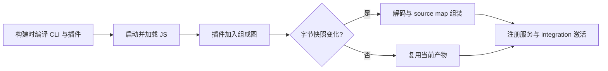

# CLI → integration 资源组装优化（2026-10-22）

本地 1 CPU / 2 GiB、交替各 3 轮：CLI → integration 中位数 **6.303 → 4.357 秒（减少 30.9%）**。ACS 原有 **15.058 秒**是另一环境的单次样本，新版本尚未部署到 ACS，不能写成“15.06 → 4.36 秒”。本轮未操作生产沙箱。

## 实测

| 轮次 | 原版 CLI → integration | 优化版 CLI → integration |
|---|---:|---:|
| 1 | 6.303 s | 4.258 s |
| 2 | 7.127 s | 4.375 s |
| 3 | 6.256 s | 4.357 s |
| 中位数 | 6.303 s | 4.357 s |

从本地 Podman run 调用计时，Worker ready 中位数 **10.035 → 6.936 秒**，Web ready **10.180 → 7.488 秒**。6 次全部 Worker 上线、HTTP 200、无资源同步/Skill 同步错误。主要结论使用 CLI 日志到 integration activate 日志的差值，减少启动器及容器创建开销的影响；计时由同一个宿主日志采集器完成。

Podman Apple Silicon VM 执行 linux/amd64，两组均限制 1 CPU / 2 GiB。每次新容器、新本地用户目录，共用同一隔离 Redis 夹具（59 员工、6 专家团、43 Skill 关联），没有 NAS 延迟模拟。源配置只读，源 Redis 只读复制，Worker 仅连接测试 Redis，未调用模型。宿主镜像/文件缓存未强制清空。

此次 A/B 基于本轮开始时的 ByClaw `873ed9b02`，提交前已衔接远端后续业务修复及 byCLI 更新；这些其他改动不属于本次 A/B 的变量。对照镜像由已完成的最新插件 builder 产物覆盖旧完整镜像，包含与 17:19 ACS 样本一致的 integration 编译产物；候选只替换 client-modules。此次完成定向产物构建与容器启动验证，**没有重新完成整张发布镜像的全流程构建**。所有原始容器日志保留在本机私密临时目录，不提交凭据/业务数据；[脱敏逐阶段结果](client-composition-benchmark.json)可复核计时。

## 原因及实现

CLI 和插件此前已经编译成 JS。CPU profile 在 integration 激活前记录 8.185 秒（带 profiler），client-modules 资源组装约 2.135 秒 CPU，其中逐字符换行计数约 0.880 秒。它拼接的是已编译浏览器产物和 source map，并非运行时再次把全部插件从 TypeScript 编译。

修改通过 `scripts/prepare-dsh-client-modules.mjs` 应用到镜像构建临时工作区的固定 DSH `0.1.5-rc.2`：

1. 换行计数改为 `indexOf`，避免逐字符 JS 迭代。
2. 每个插件字节快照只解码、清理调试指令、构造 source map section 一次，WeakMap 不保留已释放记录。
3. 未变化的单插件及批次复用生成产物；缓存只保留当前组成图。bundle/source map/记录/版本变化都会失效。
4. 保留图拓扑及启动错误检查、热重载、一代旧批次 URL、GET/HEAD/405 行为。授权资源同步与 Skill 版本逻辑不变。
5. 两个 Dockerfile 构建期重新编译该包，复制 `src` 和 `lib` 到最终镜像；无需新增 `.env` 配置。未知版本、未知或部分修改的源码拒绝应用。

## 验证

- 先在未优化编译产物复现：同一 bundle 首次被解码 2 次，新增性能断言失败；候选只解码一次，后来加入其他插件不重复解码。
- 真实 `tsc -b` 与 `tsdown` 编译通过。client-modules 的 Node 与浏览器产物通过官方 client 构建阶段输出（host 阶段会跳过该包）。
- 上游 `node-half.client.spec.ts` **41 项通过**。
- 新编译产物回归：多字节/CRLF source map 行偏移、普通/HMR/仅 map 更新、移除插件、一代旧 URL、HTTP 方法契约通过。
- 原版/候选 4 代组成图输出的 JS、source map SHA-256 和 revision URL 完全一致。
- 补丁幂等、未知/部分源码、版本拒绝、路径逃逸拒绝测试通过；两个 Dockerfile 布局检查通过。
- 上游 type-aware lint 在本地 amd64 模拟环境启动 `tsgolint` 失败：`Cannot allocate memory`，不能宣称该检查通过；TypeScript 构建及运行回归已通过。
- 本轮没有修改 integration 业务逻辑，不将此前其他插件历史测试失败宣称为已解决；也不以启动成功代表模型或所有工具调用验收。

## ACS 复测

用户重新构建并部署 D0.6.0 业务镜像后，读取新 Pod UID、镜像 digest 和时间戳；比较 `starting CLI` 与 `startup phase=activate;`，并独立记录 Worker/Web ready。当前 ACS 基线为 17:19 样本：CLI → integration 15.058 秒，Pod 创建 → Worker 31.846 秒。不能按本地比例推算云端耗时或宣称已达到 ACS 30 秒目标。
