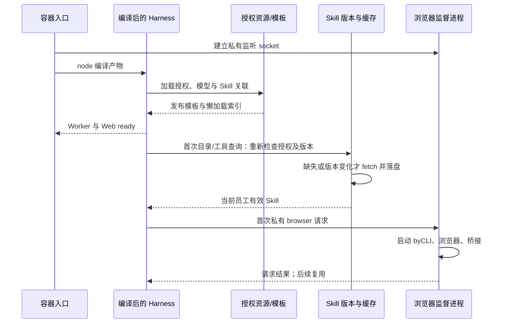

# Harness 启动优化与验证（2026-10-22）

目标：缩短 ACS 沙箱从创建到业务 Worker/Web 可用的时间，目标 30 秒内。本轮只读调查 ACS，代码与 Podman 验证由本地执行，ACS 部署由用户操作。

## ACS 原始基线

对象：`byclaw-408d6a5d153f465091ea24d87eb010bd`，1 CPU / 2 GiB，镜像标签 D0.6.0。通过 229 上 platform 的 Kubernetes 连接参数读取事件和日志，未修改该沙箱。

| 阶段 | 北京时间 | 从创建累计 |
|---|---|---:|
| 实例创建 | 14:06:07 | 0 秒 |
| 镜像缓存命中 | 14:06:12 | 5 秒 |
| NAS 挂载事件 | 14:06:13 | 6 秒 |
| 主容器启动 | 14:06:20 | 13 秒 |
| 受管插件链接准备 | 14:06:23.642 | 16.642 秒 |
| byCLI daemon 启动 | 14:06:26.212 | 19.212 秒 |
| Chromium 启动 | 14:06:34.182 | 27.182 秒 |
| byCLI 扩展连接 | 14:06:35.081 | 28.081 秒 |
| integration 路由初始化日志 | 14:06:58.256 | 51.256 秒 |
| Worker ready | 14:07:04.698 | 57.698 秒 |
| Web 启动完成 | 14:07:07.092 | 60.092 秒 |

此实例已经命中镜像缓存，主要额外耗时在容器内。Kubernetes TCP readiness 在 14:06:51 出现，比业务 Worker 提前约 14 秒，不能作为业务就绪指标。

## 实现

1. 镜像构建期编译 DSH 和插件，运行入口改为 `node apps/cli/lib/bin.js`，保留显式源码入口用于回归比较。
2. 默认 `BYCLAW_BROWSER_STARTUP=on-demand`。私有 Unix socket 先监听，首次 browser 请求或受管 byCLI 命令激活 Chromium/桌面/桥接，首个连接通过继承监听 FD 保留。密钥 FD、0600 权限、进程清理和桥接恢复仍保留。`eager` 可用于对照。
3. 冷启动同步员工/专家团授权、模型和 Skill 关联索引；业务 Skill 在当前员工查询 registry list/snapshot/get 时加载，包括工具和提示词目录查询。
4. 查询时检查版本；缓存缺失、不完整或版本变化才下载并原子替换。同一 Skill 并发请求合并，下载后复核授权/关联，代际变化拒绝发布旧结果。失败按原 `allowSkillSyncFailure` 处理，后续查询可重试。
5. 修正构建时 CLI 检查产生的 root 所有 `.dsh` 目录；镜像末尾恢复运行用户归属，避免首次启动链接失败。
6. 内置 Skill 与模板读取采用有界并发，成功的资源同步不再重复读取刚发布的 Skill 代际。增加分阶段耗时日志，不记录凭据或 Skill 内容。

浏览器首次使用及 Skill 首次查询会承担各自的加载时间；Worker 就绪不表示所有资源已预热。专家团临时作用域员工本来就按调用准备，继续保留该路径。

## 启动与首次使用路径

## 验证边界

- Podman 在 Apple Silicon VM 上运行 linux/amd64 镜像，限制 1 CPU / 2 GiB。容器内计时不包含 ACS 调度、镜像分发或 NAS 远程 IO。
- 用户指定的 `.env` 只读使用；从源 Redis 只读取得启动资料，复制到一次性、无磁盘持久化的 Redis。Worker/Stream/心跳只操作测试 Redis。
- 实际资料规模：59 个员工、6 个专家团、43 条 Skill 关联。保留真实后端地址和模型配置，未发起收费模型推理。
- 229 上的独立验证容器已删除，生产实例未变动。

## 回归结果

- Skill registry：25 项通过，覆盖绑定隔离、懒加载、并发合并和撤权代际竞态。
- 缓存：首次下载、版本变化、缓存缺失、相同版本/变化下载地址复用、失败及安全检查通过。
- 官方编译 CLI：创建会话、FIFO 后续消息、实时输出、模板 Skill、落盘及第二进程冷恢复通过；增加懒加载断言后同样通过。
- 44 个 integration 脚本：39 个通过，5 个失败。在未修改的 `f706d3fa8` 源码容器重新编译后，以下 5 个失败均复现：`group-coordination`、`group-assistance-summary`、`web-auth-apply`、`async-turn-completion`、`background-followup`。不能宣称整套历史回归全部通过。
- 两份 Dockerfile 静态布局检查通过；Podman 完整构建、镜像内权限/监督进程/密钥 FD 验证通过。

## Podman 实测结果

每次都创建新的容器及新的容器内工作目录；同一镜像已在本地。计时从 `podman run` 调用开始，到 Worker online 与 Web ready 同时出现，并验证 HTTP 200。原始阶段数据见 [timings.json](timings.json)。

| 指标 | 编译入口＋浏览器按需，三轮 | 源码入口＋浏览器预启动，对照一轮 |
|---|---:|---:|
| 受管链接准备 | 0.936–0.952 s | 0.970 s |
| 开始执行 CLI | 1.021–1.042 s | 15.891 s |
| integration 激活 | 7.663–8.100 s | 30.303 s |
| 内置 Skill 就绪 | 9.298–9.855 s | 30.365 s |
| 业务资源投影发布 | 10.001–10.603 s | 30.899 s |
| Worker 就绪 | 10.184–10.751 s | 31.008 s |
| Worker/Web 均可用 | **10.900 / 10.388 / 10.313 s** | **31.866 s** |
| HTTP | 三轮均 200 | 200 |
| 业务投影失败 / Skill 同步失败 | 三轮均 0 / 0 | 0 / 0 |

表中阶段均为累计时间。优化组三轮中位数 10.388 秒，比该对照缩短约 67.4%。对照也使用本轮 Skill 懒加载逻辑，只切换入口和浏览器模式，不能称为完整旧代码基线。输入快照为 59 名员工、6 个专家团、43 条 Skill 关联；按现有模型/资源投影规则发布日志为 authorized=60、active=60、unavailable=0、employees=56、groups=6、skills=32、skippedSkills=0。

首次使用真实 Chromium/byCLI：私有请求成功，桥接 ready 为 **14.441 秒**；验证启动前未创建浏览器、退出后私有 socket/浏览器进程已清理。该耗时在首次 browser 使用时承担，不计入 Worker/Web ready。

真实后端 Skill 验证：初始零版本请求、零下载；两次真实验证首次查询为 375 / 342 ms；标准 Skill 工具调用成功；同版本复用本地内容；删除本地 SKILL.md 后重新下载并校验内容一致；未绑定调用者不可见，测试授权撤销后拒绝访问。一次完整验证共 4 次版本请求、2 次下载（目录一次、工具的 list/get 两次、缺失缓存重查一次）。版本变更更新由隔离 HTTP 夹具验证，未修改真实 Skill 版本或业务授权。真实 CLI 端另验证 Skill 工具读取指定正文及会话冷恢复。

使用原 `.env` 时发现后端地址把端口写成 `/8080/` 路径，导致专家团投影失败；该失败组已排除。测试通过 `--base-url` 显式覆盖后端 origin/路由，原 `.env` 未改。受限 CPU 的 amd64 转译环境中启动日志出现一次 ioredis 连接超时，之后资源、Worker 和 HTTP 正常；额外连接追踪确认所有 Redis 连接均指向测试 Redis，没有连接业务 Redis。此现象保留为环境限制，不隐去日志。

**结论边界：Podman 的 30 秒启动门槛已通过；ACS 30 秒目标仍需用户部署后用实际调度、镜像缓存、NAS 和 Worker 日志复验。** 原 ACS 主容器开始前已有约 13 秒，不能将本地计时当作云端端到端计时。没有执行 ACS 部署。

## 本地复测

`scripts/startup-podman-benchmark.py` 在 Podman VM 内创建并清理自己的测试容器，记录创建调用至 Worker/Web 同时就绪的时间，并检查 HTTP 响应。前置条件是名为 `byclaw-startup-verify` 的测试网络和名为 `byclaw-startup-redis` 的一次性 Redis。

`scripts/startup-seed-verify.mjs` 读取 `/run/byclaw-test.env`，只读源 Redis，把启动输入写入测试 Redis。必须仅在独立测试容器使用，不指向业务 Redis 作为目标。原始日志保存在主机私有临时目录，不进入提交。

`scripts/browser-on-demand-verify.py` 在构建镜像内验证真实浏览器首次私有请求、byCLI 桥接和退出清理。下载网络不稳定时，Dockerfile 支持通过 `SEARXNG_WHEELHOUSE` 构建参数及只读挂载使用离线 wheel，版本仍由原 constraints 文件约束。

## CLI 构建下载优化

原 STEP 38 的 npm 日志显示，包元信息和 tarball 均已走 `registry.npmmirror.com` / `cdn.npmmirror.com`，每个请求约 27–451 ms；总安装约 2 分钟。`@larksuite/cli@1.0.85` 的官方 postinstall 硬编码 GitHub 优先、单次最长 120 秒，随后才尝试 npmmirror。

新增受版本约束的下载顺序适配，只交换镜像顺序，保留官方域名验证、SHA-256 校验、解压和 CLI 版本/普通用户访问检查。上游安装器结构变化时构建失败，要求重新审查。两份 Dockerfile 均将这两款 CLI 放入独立 connector-tools 阶段，业务插件变更无需重装固定工具。`--ignore-scripts` 仅用于先取得这两个已审查的包，随后显式运行飞书安装器；没有取消二进制安装或完整性验证。

Podman 实测：调整后 npm 包安装 2 秒；单独复测飞书二进制下载、校验和安装为 **2.106 秒**。这两项计时边界不同，不能把相加值当作 Docker 整层耗时；原整步 npm 安装日志为约 2 分钟。

真实 Skill 脚本：`plugins/byclaw-integration/scripts/lazy-skills-live-verify.mjs`，仅对 seeded `byclaw-startup-redis` 开放；在编译好的 DSH 工作区运行，并设置 `DSH_ROOT`（默认当前目录）及测试后端 `BYCLAW_DSH_BASE_URL`。它读取真实版本/下载接口，但不会执行 Skill 中的任意业务脚本、发消息或调用付费模型。完整原生会话链使用 `current-dsh-e2e.mjs` 的模拟模型输出，以免引入模型费用和随机性。
