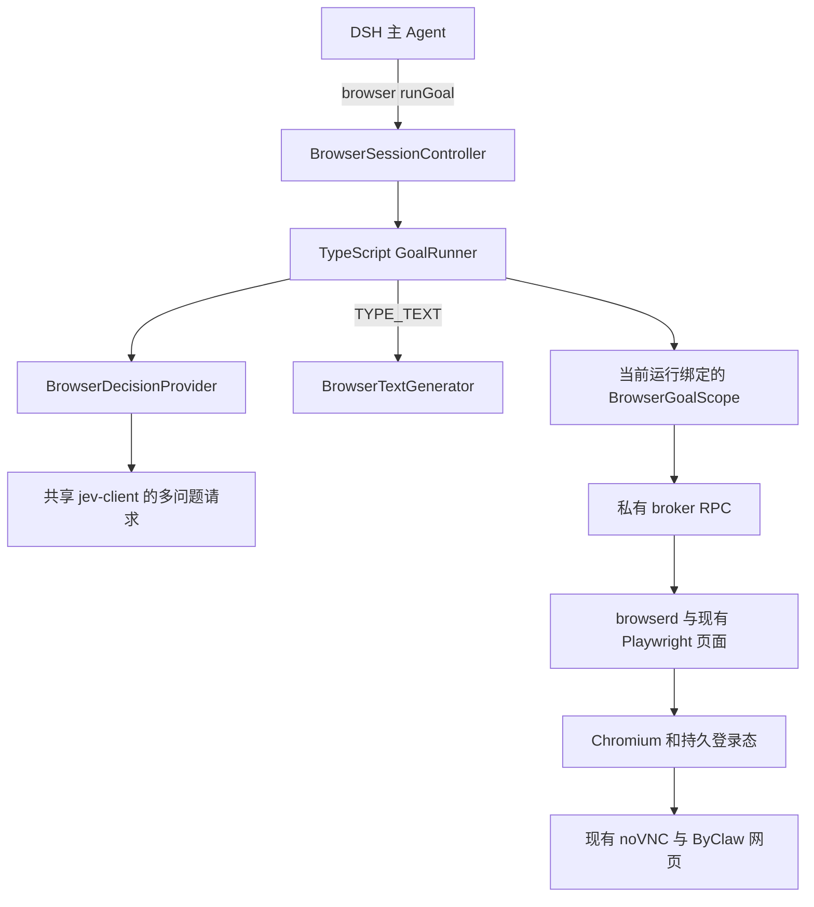

# Jev 浏览器执行原理与 DSH 接入方案

日期：2026-10-13。状态：设计稿。

采用纯 TypeScript 实现目标执行循环，参考 jev-ultrafast 的有限动作选择、操作与目标并行判断、按需文字生成和页面状态检查。DSH 主 Agent 下发网页任务，Jev 在任务范围内决定下一步，现有 browserd 执行动作，Chromium 和 noVNC 继续提供登录态与实时画面。

## 核心原理

### 根据页面生成有限动作

每次观察读取 URL、标题、视口正文、控件状态及当前可执行动作。执行器为实际 DOM 节点保留稳定身份，给本次观察中的候选动作分配编号；模型只能选择提供的编号。模型不生成 selector、坐标、JavaScript 或 shell 命令。

同一个输入框可以提供 CLICK 和 TYPE_TEXT 两种动作。原生 select 的每个有效选项提供独立 SELECT 候选。只有页面还有滚动空间时才提供相应滚动动作。WAIT、DONE 和 BLOCKED 补足加载、完成及受阻状态。

上游实现：[snapshot.js](/Users/tangs/Desktop/open-source-project/jev-ultrafast/jev_ultrafast/snapshot.js:55)、[action_space](/Users/tangs/Desktop/open-source-project/jev-ultrafast/jev_ultrafast/model.py:48)。

### 一次请求判断操作和目标

一次 TypeSafe 请求包含 operation，以及存在相应候选时的 click_target、type_text_target 和 select_target。所有问题共享同一页面状态；目标问题明确假设执行的是该操作，不能依赖 operation 的答案。

执行器先校验 operation，然后只校验和使用该操作对应的目标答案。选择 CLICK 时，TYPE_TEXT 的答案不会执行；未被使用的目标答案无效，也不应阻止合法的点击决定。这里并行的是判断问题，浏览器动作仍逐步执行。

```text
当前观察
  → 一次 Jev 请求：operation + 各操作的 target
  → 校验所选操作和它的 target
  → 执行一个动作
  → 新观察
```

上游实现：[choose](/Users/tangs/Desktop/open-source-project/jev-ultrafast/jev_ultrafast/model.py:81)。

### 需要输入时才生成文字

TYPE_TEXT 选定字段后，文字模型根据原始目标、字段含义、页面内容和近期动作返回 `{"text":"字段值"}`。点击、选择、滚动不调用文字生成模型。

上游返回值严格限制为单个 text 字段，校验类型和长度；无法提供有效字段值时停止填写，不猜测个人信息。DSH 接入将缺少必需信息归类为 needs_user。页面失效后的文字缓存只在全部文字生成上下文完全相同时复用，成功执行输入后清空。

上游实现：[field_text](/Users/tangs/Desktop/open-source-project/jev-ultrafast/jev_ultrafast/model.py:160)、[文字缓存](/Users/tangs/Desktop/open-source-project/jev-ultrafast/jev_ultrafast/agent.py:106)。

### 每步检查页面并记录结果

预测前确认当前观察仍有效，执行前再次检查。确认未执行的过期动作可以重新观察和决策；已派发动作或执行状态未知的动作不能自动重放。执行成功先记录动作，再读取新观察，避免读取失败掩盖已发生的操作。

上游用 60 个动作和 120 次决策限制循环；DSH 接入另加总耗时预算。DONE 仅代表模型报告完成，结果需要新观察和任务证据验证。默认决策使用结构化 DOM，截图用于展示、诊断或最终证据。

上游实现：[Agent 循环](/Users/tangs/Desktop/open-source-project/jev-ultrafast/jev_ultrafast/agent.py:52)、[执行检查](/Users/tangs/Desktop/open-source-project/jev-ultrafast/jev_ultrafast/browser.py:100)。

## 接入位置

正常网页任务由 `@byclaw/dsh-browser-use` 新增的 runGoal 接收。DSH 负责整体任务和后续交付；TypeScript GoalRunner 负责一段有边界的浏览器任务。browserd 保持浏览器执行服务职责，模型调用位于插件侧。



纯 TypeScript 实现应用这些原理；Python Agent、Browser Harness 和上游 Demo 不参与运行。Jev 仍作为外部决策模型使用，仓库中的 Agent 代码不能代替 Jev 模型本身。

浏览器执行接入不要求修改 DSH agent-loop。当前文档中的“插件不调用模型”和“Agent 是唯一动作规划者”需要更新，说明 DSH 下发目标、Jev 执行浏览器子任务的分工。

## 复用现有共享客户端

当前工作区已有 `@byclaw/jev-client`，使用官方 TypeSafe SDK，通过 Vercel 的 TypeSafe 兼容接口请求 Jev。已有配置、AbortSignal、错误归一化、无隐式 SDK 重试和 Choice 校验可复用。

当前 `selectWithJev()` 只构造 `questions.route`。新增通用多问题请求接口，保留原函数签名及返回行为，避免影响员工路由和生成模型路由。

```ts
// 拟新增接口；具体类型与 SDK 已有 Choice 类型对齐。
askChoiceQuestionsWithJev(state, questions, options)
validateChoice(answer, criteria)

// 既有接口保持兼容。
selectWithJev(state, criteria, instructions, options)
```

通用请求层检查响应容器、模型与有界用量字段；每个调用方验证自己使用的答案。浏览器先验证 operation，再验证所选 target。不得把四个问题拆成四次单问题调用，也不得因为未选 target 的无效答案执行另一种动作。

配置沿用 `BYCLAW_JEV_BASE_URL`、`BYCLAW_JEV_MODEL`、`BYCLAW_JEV_API_KEY` 或 `AI_GATEWAY_API_KEY`、`BYCLAW_JEV_TIMEOUT_MS`。当前默认 Gateway 地址和模型以共享客户端的配置解析结果为准，不在浏览器插件再建立一套 TYPESAFE_API_KEY 配置。

已有 SDK 类型支持多 questions，但现有客户端测试和 Gateway smoke 主要覆盖单 route。实施时补多问题离线测试，以及固定合成页面状态的 Gateway 联调。

来源：[jev-client](/Users/tangs/iwhalecloud/byclaw-harness/plugins/jev-client/src/index.js:11)。

## 页面观察与动作映射

复用 ByClaw 当前私有 JSHandle 中的 WeakMap 和 observed 节点表。扩展现有快照，不引入上游的 window.__jevFast 或第二套节点身份。

| 观察增量 | 目的 |
| --- | --- |
| 标准角色和动作能力 | 为按钮、输入框、contenteditable 和 ARIA 控件生成正确的 CLICK、TYPE_TEXT 候选 |
| 下拉选项的 label、value、disabled、selected | SELECT 只选择真实存在且可用的值，包含 disabled optgroup 检查 |
| href、checked、selected、expanded、readonly、submit | 提供当前状态和操作含义，裁剪不允许的候选 |
| disabled、inert、可见性和遮挡 | 过滤无法执行的控件，执行前仍重新检查 |
| 文档滚动位置和边界 | 仅提供有效的 SCROLL_UP、SCROLL_DOWN |
| 结构与内容状态令牌 | 检查预测、文字生成和执行期间是否发生相关变化 |

当前交互 selector 未覆盖全部常见 ARIA option、tab、menuitem 等角色，需和快照描述一起扩展。第一版保留上游八种标准操作和主文档滚动；嵌套滚动需要额外候选语义，后续独立验证。

适配层保留三种不同编号：

```text
Jev target，例如 [2] 或 [3:1]
  → 本次观察的 action.id
  → 稳定 element.index + 观察令牌 + 代码持有的动作参数
```

同一个 element.index 对应 Jev 的同一个 node。多个动作可以指向它，但每个 action.id 在本次观察内唯一。SELECT 的 value 从服务端观察映射中取得，模型只选择选项编号。

| Jev 操作 | browserd 执行 |
| --- | --- |
| CLICK | click 指定观察元素 |
| TYPE_TEXT | fill 指定观察元素，值来自受校验文字生成 |
| SELECT | select 指定观察元素和已观察选项值 |
| SCROLL_UP / SCROLL_DOWN | scroll，初始步长参考上游 560 CSS 像素，受配置与边界限制 |
| WAIT | 有界等待后重新观察，初始参考 100 毫秒 |
| DONE / BLOCKED | 结束决策循环，不执行浏览器动作 |

候选数量和文字长度保持有界。初始沿用 ByClaw 当前 200 个元素、视口正文 6000 字符，再为动作展开设单独上限；下拉选项和候选截断须返回省略数量。浏览器操作、域名、HTTP 方法、提交和下载策略仍由 browserd 检查。

来源：[私有节点与描述](/Users/tangs/iwhalecloud/byclaw-harness/plugins/dsh-browser-use/src/browser-snapshot.ts:7)、[当前 selector](/Users/tangs/iwhalecloud/byclaw-harness/plugins/dsh-browser-use/src/browserd.ts:61)。

## 决策请求与文字生成

浏览器的 BrowserDecisionProvider 与员工选择、对话生成模型选择是三个独立职责。它只接收当前目标、有界页面和最近动作，输出动作选择，不借用 ModelRoutingController 管理浏览器状态。

```ts
interface BrowserDecisionProvider {
  decide(input: BrowserDecisionInput, signal: AbortSignal): Promise<BrowserDecision>
}

type BrowserDecision =
  | { operation: 'CLICK' | 'TYPE_TEXT' | 'SELECT'; actionId: string }
  | { operation: 'SCROLL_UP' | 'SCROLL_DOWN' | 'WAIT'; actionId: string }
  | { operation: 'DONE' | 'BLOCKED' }
```

响应另外携带 confidence、模型名称、请求耗时和用量。目标编号、数值有限性、概率取值范围、候选键集合、概率总和及最大概率选择都由代码检查。沿用当前共享客户端的分布校验标准；低置信度处理作为独立可配置策略，不能触发未声明的替代动作。

请求概念结构：

```json
{
  "state": {
    "page": { "url": "当前 URL", "title": "标题", "text": "有界视口正文" },
    "elements": "当前编号元素和有效动作",
    "recent_actions": "最近动作及结果"
  },
  "questions": {
    "operation": { "type": "choice", "criteria": "当前有效操作" },
    "click_target": { "type": "choice", "criteria": "可点击目标" },
    "type_text_target": { "type": "choice", "criteria": "可填写目标" },
    "select_target": { "type": "choice", "criteria": "可选择目标与选项" }
  }
}
```

示例中的字符串表示有类型对象的占位说明，实际按 SDK schema 构造。不存在候选的 target 问题省略。每个问题携带完整目标和操作规则；页面内容始终作为待判断数据。

第一版 BrowserDecisionProvider 使用 Jev。普通 LLM 的结构化动作 Provider 可后续添加，不默认与 Jev 混跑或在错误时无提示换引擎。

TYPE_TEXT 单独依赖 BrowserTextGenerator。由 ByClaw integration 提供一个窄的生成接口，在 runGoal 开始时从真实调用方会话的 requestHeader 绑定已解析的 provider/model，并沿用该模型已有的供应商适配和凭据处理。Auto 已选定的实际模型直接复用，不重新路由，不接受工具参数指定模型，也不使用其他会话的模型；无需独立文字模型环境变量。输入为目标、字段、有界页面和历史；输出为 text 或 missing_required_value。该请求不提供浏览器工具，不触发主 Agent 的任务循环。

当前 DynamicModelRuntime 在 integration 内部使用，尚不是可直接注入的公共服务。实施时新增受作用域限制的生成服务或回调，不能假定现有 ctx.byClawModels 已存在。浏览器插件和 browserd 都不自行读取 Redis、解密 token 或维护模型目录。

## 工具接口与执行循环

保留工具名 browser，新增 runGoal。正常网页任务在 Jev 模式使用它；已有单步动作作为内部执行能力和明确的调试模式保留。

```json
{
  "operation": "runGoal",
  "goal": "查看仓库 README，找到安装步骤和运行条件。",
  "startUrl": "https://github.com/browser-use/jev-ultrafast",
  "allowedDomains": ["github.com"],
  "allowSubmit": false,
  "maxSteps": 30
}
```

owner、session、租约、模型配置和浏览器控制权均由服务端解析，不作为模型可选参数。已有页面优先复用；提供 startUrl 时，校验现有策略后导航到该地址，省略时从当前页面继续。请求 URL 与已有授权策略不兼容时明确返回策略错误，不关闭重开以扩大授权。新会话按当前 open 规则申请页面。run 开始前激活任务页，运行中不会另起 Chromium。

```text
解析目标与预算，绑定当前 owner/session
  → 取得 session 执行权和 Sandbox 浏览器控制权
  → 创建或复用租约页，focus，读取观察
  → 检查预算与停止状态
  → 一次 Jev 请求，校验 operation 和对应 target
  → TYPE_TEXT 时生成文字
  → 严格检查观察版本并执行一次
  → 记录已执行结果
  → 有界等待，取得新观察
  → 下一轮，或返回 reported_done / blocked / needs_user / failed
```

runGoal 占有一次完整的 session lane，租约在模型请求期间保持 activity。内部 BrowserGoalScope 直接使用该运行绑定的私有 broker 能力，不再进入 controller.execute 队列，避免等待自身完成。普通任务的 maxSteps、maxDecisions、maxRunMs 和无进展窗口由配置限制；调用参数只能降低上限。全局控制权排队使用独立的 maxQueueWaitMs；maxRunMs 从取得控制权后开始，以墙钟计时并包含人工暂停。

初始上限可采用上游 60 个已派发动作、120 次决策，部署同时必须设置独立总耗时。stale 决策也消耗决策预算；实际 HTTP 尝试、文字请求和模型用量另行计量。textCalls、连续 WAIT 和无进展由独立预算约束，达到上限返回有原因的停止结果。

## 页面状态与错误处理

现有 observationId 来源于交互结构指纹；正文变化目前仅作为 textDrift。Jev 预测依赖正文，必须增加 semanticToken，覆盖本次有界观察的结构、选项、正文和滚动状态。观察生成并保存该令牌；新增 checkState 只读比较，不更新 observed 节点表。

Jev 内部动作提交携带预期 semanticToken。browserd 在执行前利用现有 readState 核查，令牌不一致且确定未派发时返回 stale。第一版用结构和内容整体比较；无关轮播等导致反复 stale 的场景，再按测量引入目标及邻近容器的局部检查。

原 controller 对某些 stale 元素动作会刷新后自动重试一次。Jev scope 使用严格执行路径：stale 交回 runner 重新选择，不沿用旧模型决定。执行检查与 Playwright 的异步目标等待之间仍可能发生页面变化，因此不能宣称整段动作完全原子；稳定节点引用和目标可用性检查继续承担执行保护。

| 情况 | 行为 |
| --- | --- |
| 确认未执行且观察过期 | 重新观察和决策，计入预算 |
| 已执行，后续观察失败 | 保留已执行记录，恢复只读观察，不重放动作 |
| 动作是否已派发无法确认 | 停止本次自动执行，返回 execution_unknown 和可取得的页面证据 |
| 域名或提交策略拒绝 | 返回 blocked，不扩大权限 |
| 缺少用户必需字段或人工验证 | 返回 needs_user，保留任务页面 |
| Jev / 文字模型超时、限流、无效响应 | 返回 failed 和稳定原因码，正常保留页面 |
| Chromium、broker 或租约失效 | 使用现有故障清理规则，禁止旧 run 继续执行 |

来源：[结构和正文检查](/Users/tangs/iwhalecloud/byclaw-harness/plugins/dsh-browser-use/src/browser-runtime.ts:987)、[controller stale 重试](/Users/tangs/iwhalecloud/byclaw-harness/plugins/dsh-browser-use/src/browser-session-controller.ts:686)。

## 等待与性能

保留现有导航和下载意图跟踪。当前 endAction 有固定 25 毫秒等待，并等待已报告的导航或下载意图；该等待还需明确总 deadline。它不等同于 SPA XHR 或自动补全建议项准备完成。

在动作后的观察阶段补有界 settle：普通交互参考两帧或约 50 毫秒；填写 ARIA combobox 后，检测可见建议项，最多约 200 毫秒。这些是测量起点，不与现有 25 毫秒机械累加，也不以 networkidle 替代所有等待。WAIT 是独立决策，等待后重新观察。

整条链路减少 DSH 主 Agent 的逐步调用往返，但每个 TYPE_TEXT 仍需要额外文字生成。保留 Jev 选择机制不等于复现上游 CDP 执行时延；以 ByClaw 的观察、模型、动作、等待分段耗时和任务成功率验收。

## noVNC 与共同控制权

保留 shared-novnc 的 Chromium、持久 profile、8081 入口和 Sandbox 代理。ByClaw 前端按 browser 工具调用自动打开画面的逻辑继续有效。run 开始或恢复时使用已有 focus，使 noVNC 显示任务页面。

当前 noVNC 的仅查看复选框没有 AI 暂停协议。新增运行状态、暂停、恢复、取消和人工接管：暂停先停止派发新动作，等在途动作得到执行结果或明确未知状态，再确认用户接管；恢复必须先重新观察。客户端 viewOnly 辅助输入状态展示，服务端控制权才决定是否继续派发 AI 动作。

控制消息绕过长任务 lane，并绑定可信 owner、runId 和控制 generation。每次模型返回后和动作派发前核查运行授权；semanticToken 只证明页面状态，不能替代取消或暂停后的授权检查。软暂停保留页面；取消撤销当前 run 的操作授权，再按当前关闭租约语义清理；session/Agent dispose 和插件关闭均中止活动 run。

暂停期间保留 session lane、页面 activity 和 Sandbox 控制权，以便用户操作同一桌面，并使用明确配置的 maxPauseMs 限制这一保留时间。到达暂停或总运行期限时，停止该 run、返回 needs_user、释放控制权并结束 activity，页面进入现有空闲 TTL。恢复过期 run 不被接受，继续操作需新建 runGoal 并重新观察。界面显示暂停剩余时间；noVNC 输入本身不延长该期限或租约。正常结束或模型失败也只结束运行，不关闭借用页面。

Jev、旧调试动作和 byCLI UI 操作要纳入共同控制入口。当前 byCLI 通过扩展独立控制共享 Chromium，既有 session lane 不覆盖它。第一版共享桌面每个 Sandbox 只允许一个自动浏览器任务；后续并发需明确页面、登录态和可见桌面的竞争行为。

byCLI Skill 当前将网页任务路由给 byCLI 并禁止通用 browser。改为通用页面操作交给 runGoal，已有业务 adapter 按业务需要保留；会操作共享浏览器的 adapter 必须参与控制权协调。单纯改变前端工具识别不能实现这一互斥。

来源：[自动显示面板](/Users/tangs/iwhalecloud/ByClaw/byclaw-fe/src/hooks/useChat/useHandler.ts:581)、[现有取消关闭页面](/Users/tangs/iwhalecloud/byclaw-harness/plugins/dsh-browser-use/src/browserd.ts:1539)、[byCLI 路由](/Users/tangs/iwhalecloud/byclaw-harness/builtin/skills/bycli/SKILL.md:65)。

## 结果和审计

最后取得新观察，DONE 先返回 reported_done。可声明 URL、可见文字、控件状态等有类型的成功条件，由宿主进行检查；其他自然语言要求由 DSH 主 Agent依据最终观察确认。模型声明、验证状态和最终证据分别记录。

运行记录包含 runId、可信 session、步骤、动作类型、派发状态、结果、耗时和模型用量。凭据不进入请求日志、工具结果或 SSE；填写值和页面文本按现有数据规则最小化记录。完整模型输入若用于可重放审计，只进入有权限和保留策略的服务端记录，不直接全量投到前端。

在 DSH 支持的工具进度及持久事件扩展机制中注册运行记录，并同步日志读取和客户端呈现。不能只写未记录的提示词内容或发送客户端不认识的裸事件。最终工具结果保留有界步骤摘要、最后观察、下载产物和停止原因。

## 实施任务与验收

以下路径为拟新增模块，接口名可按仓库规范调整。历史设计文档保留，本设计更新当前 README 和工具说明，不改写历史记录。

| 位置 | 实施内容 |
| --- | --- |
| plugins/jev-client | 新增多问题 transport，提取 Choice 校验，保持两个 router 的单 route 接口与取消行为 |
| plugins/dsh-browser-use/src/goal-action-space.ts | 观察转有限动作，保存目标到真实节点的映射 |
| plugins/dsh-browser-use/src/goal-decision.ts | operation 和 target 问题、提示规则与结果校验 |
| plugins/dsh-browser-use/src/goal-text.ts | 文字生成接口、值校验与上下文缓存 |
| plugins/dsh-browser-use/src/goal-runner.ts | 观察决策执行循环、预算、状态、停止和进度 |
| plugins/dsh-browser-use/src/index.ts 与 browser-session-controller.ts | runGoal schema、私有 scope、session 执行权与租约 activity |
| protocol.ts、browser-snapshot.ts、browser-runtime.ts、browserd.ts | 元数据、checkState、严格动作令牌、等待 deadline 和共同控制权 |
| plugins/byclaw-integration | 提供作用域内文字生成接口，精确解析 textModelId |
| browser/novnc-index.html 与 ByClaw 前端 | 运行状态、暂停接管与恢复控制 |
| builtin/skills/bycli、工具提示和 README | 调整网页任务路由，说明权限与两层任务分工 |
| Dockerfile 与 Dockerfile.extensions | 安装共享客户端依赖和新 TS 模块，沿用现有浏览器运行环境 |

实施分三个阶段：先完成离线决策和 broker 接通，再完成停止接管及 byCLI 协调，最后通过真实任务测量后切换默认引擎。配置显式选择旧 DSH 单步模式或 Jev 目标模式；Jev 配置缺失或请求失败不隐式切换引擎。

必须覆盖的离线与本地浏览器验收：

1. 一轮只发一次多问题 Jev 请求，选择 CLICK 不消费 TYPE_TEXT 目标，非法选中目标不执行。
2. 一个节点支持多种动作仍保持同一 node；select 值来自有效选项；checkbox 和只读输入不被误判为可填写。
3. 结构变化、正文变化、滚动变化和文字生成后的 stale 重新选择；已派发或结果未知的动作不重放。
4. 相同文字生成上下文才复用值；缺少字段值返回 needs_user；成功输入清空缓存。
5. runGoal 不递归进入 session 队列；模型等待期间租约不空闲过期；session/Agent 销毁可以立即停止。
6. 暂停、取消和恢复不被 long run 阻塞；撤销授权后无迟到动作；人工接管保留页面；恢复读取新观察。
7. noVNC 显示同一租约页面，登录态和下载规则保持；byCLI 和 Jev 不同时争夺共享桌面。
8. 共享客户端扩展不改变现有 agent-router/model-router 的请求、失败、取消和用量行为。

真实联调先验证 Gateway 多问题协议，再执行公开页面导航、搜索、自动补全、下拉筛选、滚动和动态节点任务。记录成功率、端到端耗时、Jev/文字请求次数、stale 次数和用量。比较时固定网站、任务、浏览器 profile 与文字模型；任务计时包含初始观察和所有等待，另列浏览器冷启动成本。

完成条件是：浏览器任务由 Jev 连续执行，DSH 得到可验证结果；用户能在已有 noVNC 中观看、暂停并接管；浏览器租约、权限、取消和审计通过上述验收。


## 2026-10-14 实施状态

已实现独立且默认关闭的 `BYCLAW_BROWSER_JEV_ENABLED`、runGoal/goalControl、共享 Jev 多问题请求、当前会话文字模型复用、候选动作、结构与文本校验、预算、派发结果不明停止、租约保活、下载保存、结构化日志、托管 byCLI 文件锁，以及 noVNC 暂停/继续/取消。运行时对控制代次及真实 lease/session 校验；不递归占用会话执行队列。

与初始构想的具体差异：

- noVNC 先采用服务端断开输入连接的方式撤销人工控制，运行期间显示任务状态，暂停完成后重连；运行中只读直播画面尚未实现。
- 已有适用的 byCLI Adapter 保持优先，缺少 Adapter 的通用多步交互可交给 runGoal。启用时托管 byCLI 业务命令使用同一文件锁串行；管理/健康命令豁免。宿主机独立 byCLI 与绕过启动器的调用不受此锁约束。
- 文本模型服务放在 byclaw-integration，复用发起 runGoal 的当前会话实际模型（包括 Auto 路由结果），无需独立模型环境变量。每个 goal 固定自己的模型快照，后续 goal 再读取当前模型。没有可用会话模型或缺少必要输入时停止，不隐式选择另一模型；text_model 日志记录会话和实际模型，不记录输入内容或凭据。
- `verified` 只代表给定页面文本/URL 条件成立，不是业务后端验证。无条件时返回 reported_done。时限、取消和预算原因通过 status/reason 返回，已执行动作不回滚。
- 尚未跑真实 Jev/文字模型渠道或速度对照，不报告生产性能收益。部署、限制和日志见插件 README.zh.md。

本地验证记录（2026-10-14）：浏览器插件 typecheck/build、专用 headless Chromium 下 250 项聚焦回归、共享 Jev 与原有路由 46 项测试、文字服务校验、byCLI 启动器 3 项测试通过。真实 Chromium + 本地网页 + 模拟 Jev 完成填写、选择、点击和成功条件校验，未发出真实模型请求。完整 Chrome 测试进程存在间歇超时：两个快照用例首次超时，单独复跑通过；目标端到端用例曾完整通过，后续完整 Chrome 复跑也出现超时；最终使用专用 headless Chromium 的 250 项聚焦回归全部通过。生命周期抽查 4 项通过、2 项超时；在 Git 原版的独立副本上同样复现这两个超时。byclaw-integration 在当前本地 DSH 依赖下有 34 个类型错误，移除本次接入后的独立副本诊断完全相同（类型联合排序归一化后比较），本次未新增。未宣称完整测试集通过；Docker 构建、Linux noVNC 实机、真实模型渠道和性能对照尚未验证。

会话模型复用调整验证（2026-10-14）：文字服务校验覆盖实际请求模型优先于 Auto、每个 goal 的模型快照、不同会话隔离、后续 goal 使用新模型、模型缺失及调用失败不回退、严格 JSON、完整流与取消；浏览器工具注册与目标执行 90 项测试通过，browser 插件 typecheck/build 和 git diff --check 通过。integration 类型诊断仍为原有 34 项，与调整前记录逐项相同（归一化路径和联合类型顺序）；真实模型平台未验证。
